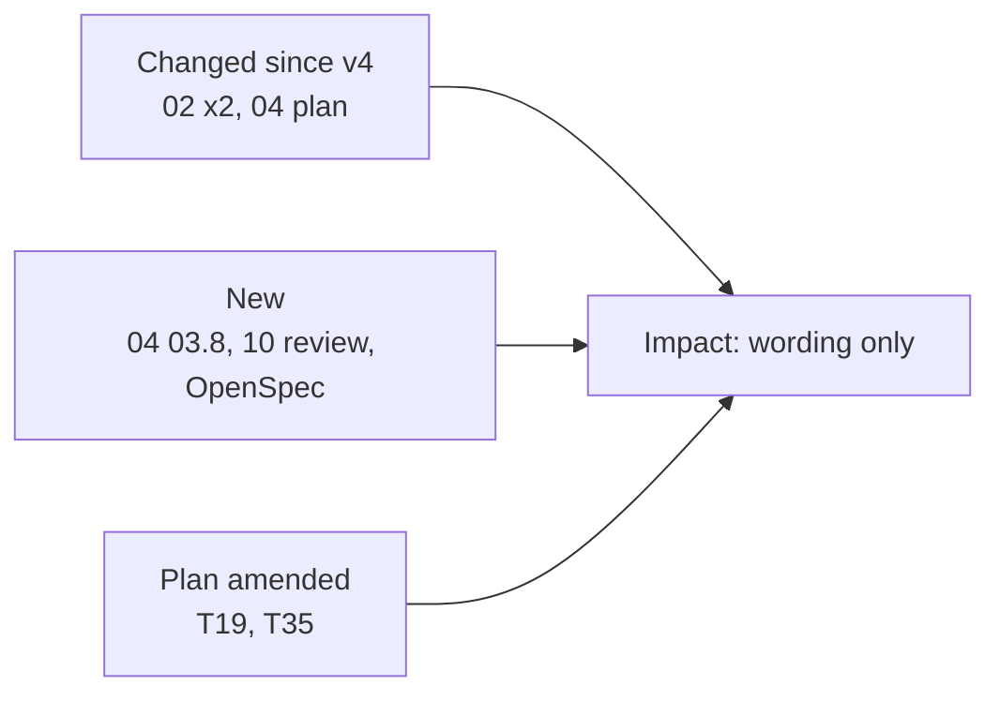

# SPRINT-003 readiness: sources B, other stages and Planning

This reference page belongs to the [readiness report v5](03.11-sprint-003-readiness-report-v5.md). Hashes are SHA-256 of the files read on 18 November 2026. Versions 3 and 4 and the plan are listed so a reader can see what the plan was when this version assessed it. Pages unchanged since [version 4's sources](03.10.2-sprint-003-reconciliation-sources.md) keep their hashes there.

*Three wording changes, new pages and a plan with two added tasks. None changes a rule.*

| Stage | Page | SHA-256 |
| --- | --- | --- |
| 02 | [03-planned-improvements.md](../02-purpose/03-planned-improvements.md) | `1664ff76721cafe462f3c3c447edf52b527d80deef1dd5e9dd9d26f50a13285d` |
| 02 | [03.2-sprint-003-prepared-context-proposal.md](../02-purpose/03.2-sprint-003-prepared-context-proposal.md) | `b66e4ba224ce0687a85ff48c3fb940095675ae7ea486c4d10493a9f62e221031` |
| 04 | [03.6-sprint-003-evaluation-plan.md](../04-benchmarks-and-eval-strategy/03.6-sprint-003-evaluation-plan.md) | `f81510a1edc2844cd4a2f169f955590d509d5f1b5be7987ff76a6cbe395a02d2` |
| 04 | [03.8-sprint-003-package-and-statement-checks.md](../04-benchmarks-and-eval-strategy/03.8-sprint-003-package-and-statement-checks.md) | `32c8080211adfd3e97f5aa645e046f2ab7375f7b601446a9473a9a4ce297bfa3` |
| 10 | [03.1-sprint-003-specification-review.md](../10-document-review-and-release/03.1-sprint-003-specification-review.md) | `b7f65027de8bcb3bf1e77d4a5ff3951e88faff1a1a2bd979842be7b4b10f6057` |
| 10 | [03.2-sprint-003-specification-recheck.md](../10-document-review-and-release/03.2-sprint-003-specification-recheck.md) | `9d1ed864817bf7020c5a75cfee7c5ac2aa8d3fea452fe46b8798f7ffbafc3d0f` |
| 10 | [03.2.1-sprint-003-recheck-closure.md](../10-document-review-and-release/03.2.1-sprint-003-recheck-closure.md) | `cc7b9be8c104b464dd7356fa55d316d2be49547221dc53cfa0a1ffc43f1bb28c` |
| 10 | [03.2.2-sprint-003-recheck-remaining.md](../10-document-review-and-release/03.2.2-sprint-003-recheck-remaining.md) | `ab1d028b7b70dc89b91e71308735169420c3a4d6fa65dba069af37d8a5c8ba4e` |
| 08/OpenSpec | [proposal.md](../../../openspec/changes/sprint-003-proposed-answer/proposal.md) | `18ae10701581c2698591b2ae64bc3b76e5cc62b8e2925ee8bc598298ff7609a2` |
| 08/OpenSpec | [design.md](../../../openspec/changes/sprint-003-proposed-answer/design.md) | `1ba0c5d40bff88722841aaedb00e573e1a5985b2c279640292b6f092166d57ee` |
| 08/OpenSpec | [tasks.md](../../../openspec/changes/sprint-003-proposed-answer/tasks.md) | `a92828d957718852a3fb347c439340889d295f8d4388d17b434e33c1a64b51d4` |
| 07 | [03.9-sprint-003-plan.md](03.9-sprint-003-plan.md) | `d9e417f155564b91d2e27f3aecff0087107e724252661d418c637ba2dad5fd02` |
| 07 | [03.9.1-sprint-003-plan-specification.md](03.9.1-sprint-003-plan-specification.md) | `aa2db17b81357af5941a7010faec8f142b4957e01ea4a4251989227779135b57` |
| 07 | [03.9.2-sprint-003-plan-build.md](03.9.2-sprint-003-plan-build.md) | `a97a91701c057c5201f9efd5909e52ee29fbd107129618994d1cbf322684fbbf` |
| 07 | [03.9.3-sprint-003-plan-trace.md](03.9.3-sprint-003-plan-trace.md) | `0f1e86837cd6ef9a671b611105420916458adf5aded0014eb5789428bdfffcde` |
| 07 | [03.10-sprint-003-alignment-report-v4.md](03.10-sprint-003-alignment-report-v4.md) | `c561b226e4165feafa8aeab4fab7b1da9247fdc5c6d7bf8366b56a4625186438` |
| 07 | [03.7-sprint-003-alignment-report.md](03.7-sprint-003-alignment-report.md) | `3a9c38bdc8ffdf9db58d4f5cd85c55cebb72ff34afe4816265666eebcc6c490e` |

The plan pages `03.9`, `03.9.2` were amended after v4, and `03.9.2` and `03.9.3` again for the T31 owner (T19 and T35 added, ranges updated); the earlier hashes were `6dbc60f3b38ae221e1af755588cf2256b3ad7040163d94e61b82446a80dde5ac` and `456386f4c4a7a7aec2a3bd15237617744a3c8a039f1dac68940b6232d11e8587`. Other evidence: `.asdg/sprint.json` `90d6dab6bb3d43b1b16d71a153796a27c3c757339a4291682d7d979b05d69131`, root `AGENTS.md` and `poc/README.md` unchanged, `poc/alice-run.sh` absent.
Return to the [report](03.11-sprint-003-readiness-report-v5.md) or to [Planning](README.md).
