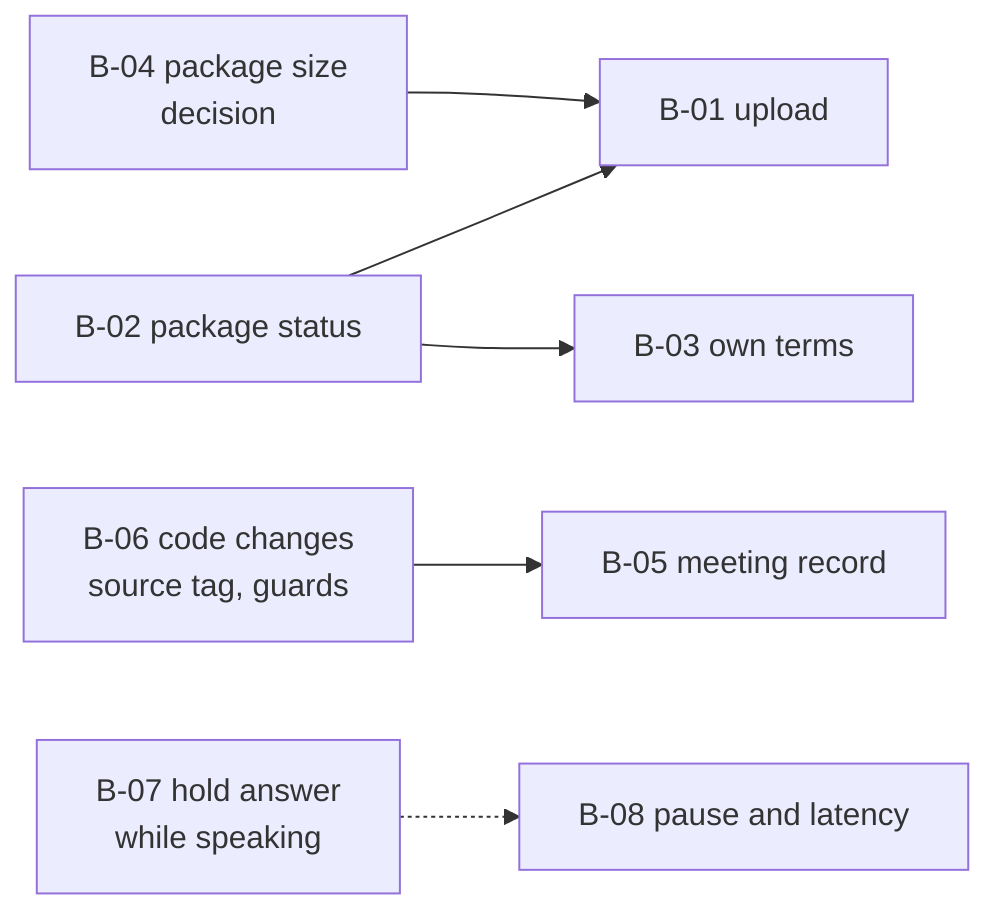

# Alice backlog: stories ready to plan

This is Pablo's agile backlog for Alice (Alice.Good.Meetings), drafted by 07 Planning on 19 November 2026 from the sessions of 18 and 19 November. It is a draft: nothing here is approved, no sprint is started or changed, and SPRINT-003 is untouched. Stories are written "As Pablo I want ... so that ...", sized S, M or L by a rough guess, and each points to the page that holds its detail. The [later and parked stories](03.12.1-product-backlog-later.md) follow, and the [SPRINT-004 proposal](03.13-sprint-004-proposal.md) picks from both.

*Dependencies between the stories that could start soon. Solid arrows mean the second needs the first or its decision.*

## Ready or nearly ready

| ID | Story | Acceptance idea | Size | Needs | Source |
| --- | --- | --- | --- | --- | --- |
| B-01 | As Pablo I want to upload my preparation package from the page, several files first and a zip later, so that I need no files on the machine | Pick `.md` or `.txt` files; they replace the package, stay in memory, never written to disk, skipped files named | M | B-02; 05 questions Q1 to Q4 (Q5 for zip); 03 UC-07 accepted | [UC-07](../03-system-model-and-use-cases/01.7-load-preparation-package.md), [05 01.8](../05-high-level-design-and-architecture/01.8-package-upload-and-vocabulary.md), [01.8.1](../05-high-level-design-and-architecture/01.8.1-upload-limits-and-statements.md) |
| B-02 | As Pablo I want the page and the service to show the package (name, files, characters, terms, source) so that a missing or wrong package is obvious before I press Start listening | Before Start the page names what is loaded or says "no package"; the service returns the same without package text | S to M | 05 `GET /package` accepted | UC-07 (the 18 November wrong-package failure), 05 01.8 |
| B-03 | As Pablo I want a list of my own terms (for example Simplii, CIBC Simplii) so that names in no document reach the transcription hint | Up to 40 terms, shown "3 yours", ahead of package terms; never cut by the existing hint limits | S | B-02; Q3 (remember in the browser) | 05 01.8; `poc/vocabulary.mjs` |
| B-04 | As Pablo I want the 20,000-character package limit reconsidered so that my real package fits | A recorded decision: raise, summarize, pick files or read subfolders; the CPPIB package is about 130 KB in 32 files and a 3-file subset was installed by hand | M | Pablo's decision; 04 cost and recall; a new data statement | UC-07; 01.8.1; this backlog |
| B-05 | As Pablo I want a local record of each meeting so that I can review my own performance later | After each turn and at the end, a Git-ignored record with timestamped segments, pauses, Focus changes and source, answers shown, cue state over time, package name and size, never its text | L | B-06 source tag; data statement and retention rule; 12, 05, 04 | [12 Observability](../12-observability-insights-and-learning/README.md) (empty today); 05 audit |
| B-06 | As Pablo I want 05's small code changes so that what is sent is visible and idle pauses cost nothing | Print covers the post-pause request and hint; source tag (speech or button) on Focus and audit; no request when no new speech; term list and count in print and audit | S to M | none | [05 03.4](../05-high-level-design-and-architecture/03.4-18-november-code-assessment.md) C1 to C3, C5 |
| B-07 | As Pablo I want a new answer held while I am speaking so that text does not move under my eyes | Answer waits for the next pause; the cue is unchanged; a flag turns it off | M | Pablo's decision on flag F2; 03 scenario; 04 check | 05 03.4 C4, F2 |

Return to [Planning](README.md).
