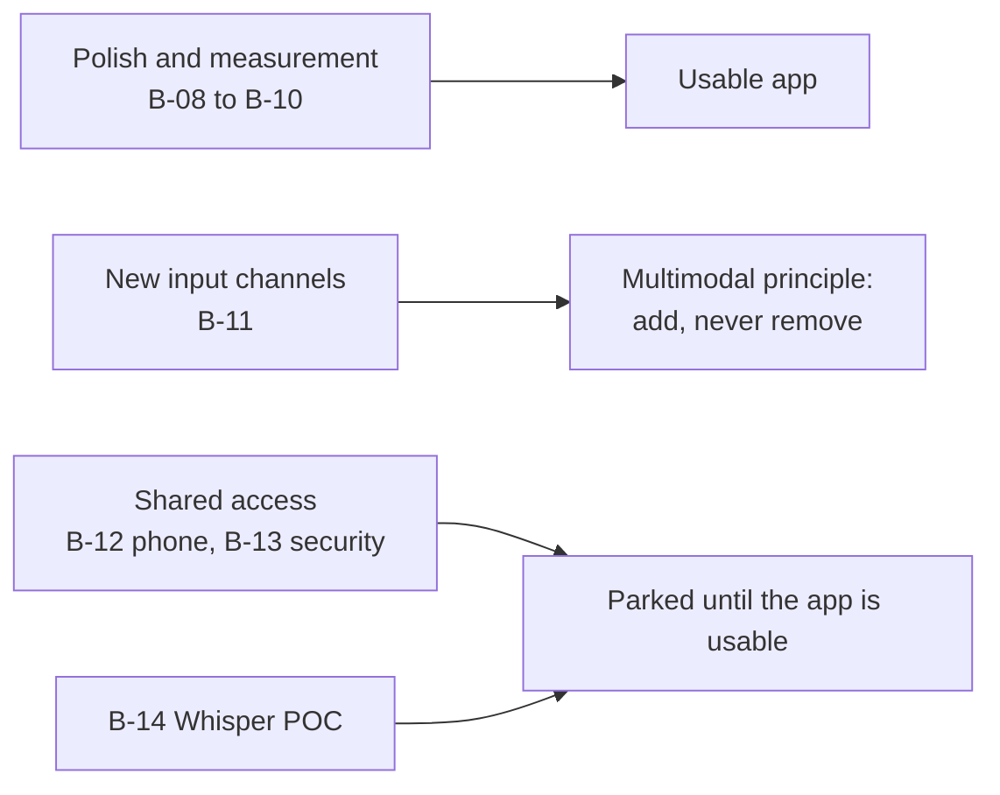

# Alice backlog: later and parked stories

This page belongs to the [product backlog](03.12-product-backlog.md). It holds the stories that need a decision, are small polish, or that Pablo parked. Draft of 19 November 2026; nothing is approved and no sprint changes.

*Three groups: small improvements that follow the first sprint, new channels, and parked work.*

| ID | Story | Acceptance idea | Size | Needs | Source |
| --- | --- | --- | --- | --- | --- |
| B-08 | As Pablo I want to know where the wait after a question goes, and to adjust the pause, so that answers come when I need them | The three parts (800 ms pause, fixed 2.5 s `reasonDelayMs`, model call) are measured; the pause is adjustable from the page or one setting (`ALICE_PAUSE_MS` exists). He finds the wait "a little long but acceptable" | S to M | a live session; 04 definition | [05 03.2](../05-high-level-design-and-architecture/03.2-answer-delay-question.md), 05 03.4 F4, `HANDOFF-2026-11-18.md` |
| B-09 | As Pablo I want clear wording so that nothing sounds like an error when it is not | "agent proposal rejected; keeping previous answer" becomes "no new question heard"; the details area shows it scrolls; his list of what is "a bit clumsy" is added when he gives it | S | his list | page monitor line; [SPRINT-003 spec](../08-low-level-design/03.5.3-s003-answer-labels.md) |
| B-10 | As Pablo I want the monitor line behind the cue and hideable so that it never competes with the cue | Monitor is smaller than the cue, Focus and bullets; one control hides it and the choice stays | S | 05 flag F3 | 05 03.4 |
| B-11 | As Pablo I want gesture and video clues as new input channels so that I can steer Alice without speaking | A new channel feeds Focus through the same rules; speech and buttons still work | L | 03 and 05 channel design; 06 feasibility | [03 01.6](../03-system-model-and-use-cases/01.6-inputs-and-future-channels.md), [05 01.6](../05-high-level-design-and-architecture/01.6-input-channels.md) |
| B-12 | As Pablo I want to use Alice from my phone over Tailscale so that I need not be at the laptop | The page opens from the phone over the tailnet and works as on the laptop | M | B-13 decision; 05 | this backlog |
| B-13 | As Pablo I want sign-in and security for a shared server so that others can use it safely | Parked by Pablo: "security later". No story detail until it is selected | L | his go | this backlog |
| B-14 | As Pablo I want a Whisper POC so that I can compare transcription | Parked. A bounded experiment, if selected, framed by 06 | M | 06 decision | this backlog |
| B-15 | As Pablo I want a small Alice avatar (a state-driven talking head, V0) so that the page shows Alice's state in a friendly way | Six states drive closest built-in moods and gestures through one isolated adapter; no backend change, no speech; the page works if it fails to load | M | 02, 05, 08 answers (pending); [TalkingHead](https://github.com/met4citizen/TalkingHead) | Pablo's request of 19 November 2026 via 00 Governance; [story page](03.14.2-sprint-004-avatar-story.md); added to SPRINT-004 |
| B-16 | As Pablo I want the empty middle of the bar to show Alice's advice so that she can talk to me in the page | Pablo: "the empty space in the middle will be used later for Alice to talk or say something: we are going to write her advice". Reserved in SPRINT-004 (08 SA-19), nothing shown; text, source and rules are for a later sprint | to size | B-15 placement; his advice texts; 02, 03, 05 | 19 November 2026 via 00 Governance; SPRINT-005 candidate |

## Not stories

- **SPRINT-003 wording amendment.** Its criterion 3 says "confirmed" (the built flow answers after a pause, with Confirm optional) and criterion 9 says "only those are sent" (term hints also go to transcription). The record cannot be amended; this is a closeout item, see the [SPRINT-004 proposal](03.13.1-sprint-004-option-b-and-closeout.md).
- **Multimodal rule.** Every input stays; new ones are added. It binds B-11 and any change to buttons.
Return to the [backlog](03.12-product-backlog.md) or to [Planning](README.md).
