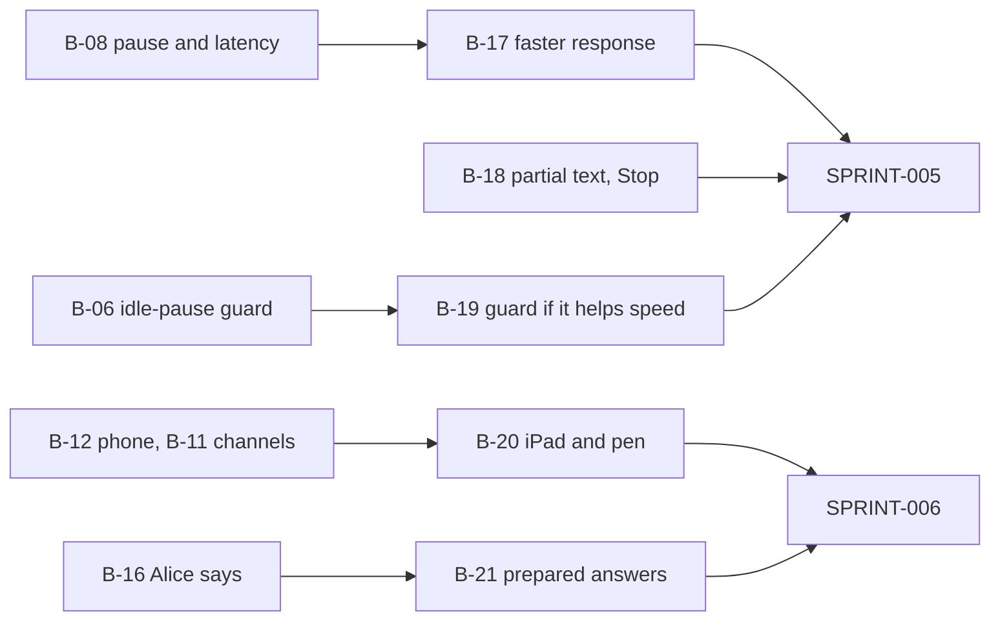

# Alice backlog: speed, iPad with pen, and prepared answers

This page belongs to the [product backlog](03.12-product-backlog.md). It records Pablo's direction of 22 November 2026, relayed by 00 Governance, for SPRINT-005 and SPRINT-006. A draft: nothing is approved. SPRINT-004 is still active and will be closed first by Pablo. The stories relate to B-08, B-11, B-12 and B-16 in the [later stories](03.12.1-product-backlog-later.md).

*SPRINT-005 is about speed. SPRINT-006 joins two parts Pablo needs together: the iPad with pen, and prepared answers.*

| ID | Story | Acceptance idea | Size | Needs | Source |
| --- | --- | --- | --- | --- | --- |
| B-17 | As Pablo I want Alice faster and more efficient, "without local LLM or anything special", so that the Question and bullets appear while the question is fresh | Same questions before and after; a measured gain from today's mean of 8.6 s (6.4 to 10.3 s over 7 live questions); cheap fixes only | M | 04 question list and pass rule; 08 log fields | 09's [response-time analysis](../../../poc/docs/08-response-time.md), [08.5](../../../poc/docs/08.5-plan-and-experiments.md); narrows B-08 |
| B-18 | As Pablo I want no Question set from half a sentence and no speech lost at Stop | The reader acts on final words only; Stop does not drop untranscribed speech | S to M | 05 and 09 confirm the findings | Deferred findings (relayed); [08.2](../../../poc/docs/08.2-causes.md) |
| B-19 | As Pablo I want the idle-pause guard (S004-GUARD, B-06 C1 and C3) if it saves calls | No request when no new speech; print covers the post-pause request | S | B-17 measurement shows it helps | [03.14](03.14-sprint-004-working-plan.md), B-06 |
| B-20 | As Pablo I want Alice on the iPad with the pen, so that I can use her in meetings without a Mac keyboard | A big writing field below all else; touch buttons for what the keys do; the hosted mode deployed | L | 05, 06; security decision; relates B-11, B-12, B-13 | [poc/deploy](../../../poc/deploy/README.md), built, not deployed |
| B-21 | As Pablo I want Alice to prepare likely questions and answers (about ten), with buttons like car-radio presets, so that I can rehearse and perform with them | Button 1 is "Tell me about yourself"; a press shows its prepared answer; one list serves preparing and performing | L | 02, 03, 04, 05; builds on B-01, B-16 | Pablo's direction of 22 November |
| B-22 | As Pablo I want to upload a whole folder or one .zip as the package, "easier" than selecting every .md file | Same limits as today (20,000 characters, .md and .txt only, skipped files named); a folder pick or a .zip replaces the package like a file pick; desktop Chrome and Safari take a folder, the iPad takes a .zip from the Files app | M | 05 limits and zip safety; 04 cases; pairs with B-20 | Pablo's feedback in the SPRINT-004 live session; narrows B-04 and B-01's "no zip" |

**Out for now:** local models, a two-lane redesign (09's later steps), and new UI in SPRINT-005; sign-in beyond the hosted access code. Return to [Planning](README.md).
