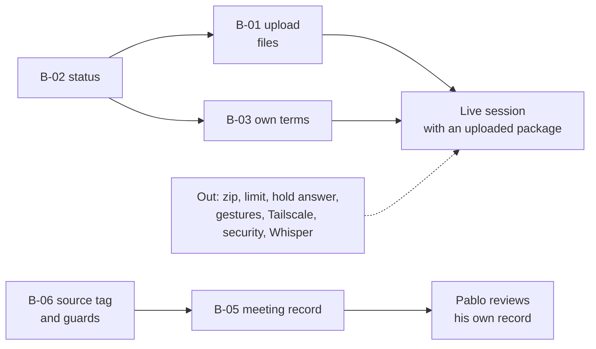

# SPRINT-004 proposal: make Alice a usable app

This is a proposal from 07 Planning of 19 November 2026 for Pablo to accept, change or reject. It starts no sprint and edits no sprint record. Pablo's direction through 00 Governance: make Alice a usable app (package upload and status, vocabulary, meeting record); security later. Stories come from the [backlog](03.12-product-backlog.md). A smaller second option is on the [next page](03.13.1-sprint-004-option-b-and-closeout.md).

*Option A: five stories in one theme, ending in a live session and his review of the record.*

## Option A

**Theme:** Alice you can trust and review.
**Objective (draft):** *Let Pablo load his preparation package and his own terms from the page, see before Start what is loaded, and keep a local record of each meeting for his own review.*
**Stories:** B-02 package status, B-01 upload of several files, B-03 own terms, B-06 source tag and guards (print, idle pause), B-05 meeting record, and the "no new question heard" wording from B-09.

**Scope (draft, exact paths):** `index.html`, `index.md`, `app.js`, `app.md`, `images/`, `poc/`, `openspec/changes/`. The record is written under a Git-ignored folder in `poc/`. Documents under `docs/asdg/` stay outside any scope.

**Acceptance criteria (draft):**
1. Before Start the page shows the package name, files, characters used, term counts (total and his own) and source, or says "no package"; the service returns the same without package text.
2. Pablo picks several `.md` or `.txt` files on the page; they replace the package, are never written to disk, and skipped files are named with the reason. Upload is refused while listening and a failed upload keeps the old package.
3. Up to 40 own terms are entered on the page, counted apart and placed ahead of package terms in the transcription hint.
4. Each Focus change carries its source, speech or button, on the page's audit and in the record.
5. After each turn and at the end of a meeting a local Git-ignored record is written with timestamped transcript segments, pauses, Focus changes and source, answers shown, cue state over time, and package name and size, never package text.
6. The data statements in the root `AGENTS.md` and `poc/README.md` say what upload and the record keep and send; the retention rule is stated and the "no persistent conversation storage" sentence is replaced.
7. `node --test poc/poc.test.mjs` and the scripted page check pass, with new cases for each criterion.
8. Pablo runs one live session with an uploaded package, reviews the record afterwards, and the result is recorded by the rule 04 sets.

**Deliberately out:** zip upload, raising the 20,000 limit (B-04 is a decision only), holding answers while he speaks, pause measurement, monitor placement, gesture and video, Tailscale, sign-in and security, Whisper.

## Documents that must exist before coding

| Stage | Document | State |
| --- | --- | --- |
| 02 | Boundary for a stored meeting record and for upload: what is kept, where, for how long | Missing |
| 03 | UC-07 accepted by Pablo; a new use case for the meeting record and its review | UC-07 draft only |
| 04 | Checks for status, upload limits, vocabulary reaching the hint, record completeness, no package text, Git ignore | [03.9](../04-benchmarks-and-eval-strategy/03.9-sprint-003-automatic-flow-and-channels.md) covers the flow only |
| 05 | Pablo's answers to Q1 to Q4; 01.8 accepted; a record design and data statements | Draft, Q1 to Q4 open |
| 08 | Specification, test map and an OpenSpec change `sprint-004-...` | Missing |
| 12 | What the record must let him learn | Empty |
| 07 | The plan, after alignment | After the above |

Return to the [backlog](03.12-product-backlog.md) or to [Planning](README.md).
