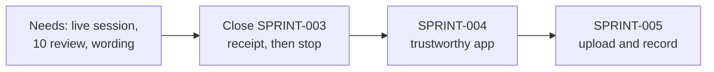

# SPRINT-004: a smaller option, and closing SPRINT-003 first

This page belongs to the [SPRINT-004 proposal](03.13-sprint-004-proposal.md). It gives a smaller, better-ordered option and answers whether SPRINT-003 must close first. Draft of 19 November 2026; it starts and stops no sprint.

*Option B ships the visibility and vocabulary first; upload and the record follow once their data decisions exist.*

## Option B: a smaller sprint

**Theme:** Alice you can see and tune. **Stories:** B-02 package status, B-03 own terms, B-06 source tag and guards, B-09 wording, B-10 monitor line. **Out:** upload, record, zip, limit, hold answer.
**Why it may be better:** the wrong-package failure of 18 November is solved by status alone; the record needs the source tag first and a new data decision, and upload needs Pablo's Q1 to Q4 and the B-04 limit decision. Option B needs far fewer new documents (status and vocabulary criteria in 04, one 05 page, a small specification), so coding starts sooner. The cost is that the record and upload wait one sprint.
**Recommendation:** Option A is workable only if the stage 02, 03, 04, 05, 08 and 12 documents in the proposal exist before coding. If the record's retention and data statement are not decided, choose Option B and make upload and the record SPRINT-005.
Criteria 1, 3, 4 and 7 of Option A apply; the objective drops "load" and "record".

## Should SPRINT-003 close first?

**Yes.** `sprint start` refuses while another sprint is active, needs a clean Git worktree and creates a new branch, so SPRINT-003 closes first by Sprint close. Nothing is started by this page. As of 19 November 2026 the gate allows implementation and `.asdg/sprint.json` still holds the nine SPRINT-003 criteria.

| Closeout needs | State seen |
| --- | --- |
| Criterion wording | Criterion 3 says "confirmed" and 9 says "only those are sent"; the built flow answers after a pause and hints go to transcription. The record cannot be edited, so these two cannot pass as worded. Close with the outcome `unfinished`, or `completed` only with PASS evidence for every criterion |
| Recorded live session (criterion 7) | No recorded result found in the project pages |
| Independent review by 10 Review and Release of the built candidate (T41) | Reviews of the specification, baseline sizes and run script exist; none of the built candidate was found |
| Data statements (T31, T32) and checks (T33, T34) | Root `AGENTS.md` still says only audio and transcript go to OpenAI; no statement check or package check result found |
| Clean worktree | Documents and `poc/vocabulary.*` are uncommitted, so Pablo commits first |

Pablo decides; the receipt carries the carry-forward items, including this backlog. Return to the [proposal](03.13-sprint-004-proposal.md) or to [Planning](README.md).
