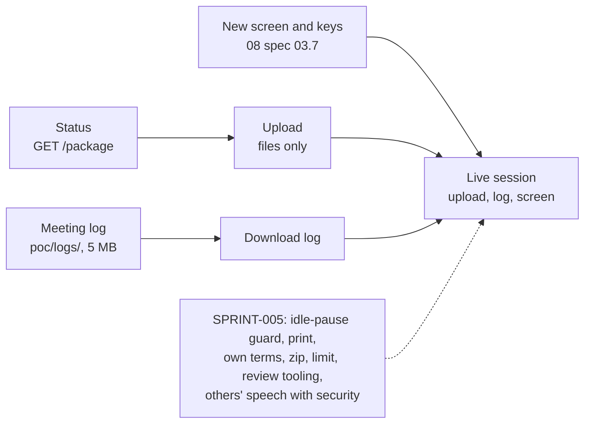

# SPRINT-004 plan, version 6: upload, meeting log and the new screen

This is a draft of 07 Planning, 19 November 2026, version 7 (adds the avatar story B-15 as S004-AVATAR, criterion 11, final avatar criteria and logo placement; version 6 criteria 1 to 10 unchanged), issued after the first sprint-align round of 02, 03, 04 and 05 (all `CHANGE_REQUIRED`) and Pablo's decisions on it, relayed by 00 Governance. It supersedes versions 1 to 5 (the same file). It starts no sprint and edits no sprint record; the pages stay drafts. SPRINT-003 is closed as unfinished and no sprint is active.

*Three streams meet in one recorded live session; the idle-pause guard now waits for SPRINT-005.*

## Draft sprint record

**Theme:** Alice you can load, use and review in any meeting.
**Objective (draft):** *Let Pablo load his package from the page, see what is loaded, work from the new screen, and keep a complete local log of each meeting that he can download.*
**Stories:** B-02, B-01 (several `.md` or `.txt` files; no zip, no folder pick), the meeting log with Download log, the new screen (replaces B-10, part of B-09), B-09 wording, B-15 Alice avatar (small, see the [avatar story](03.14.2-sprint-004-avatar-story.md)). **Moved to SPRINT-005 by Pablo:** S004-GUARD (B-06 C1 and C3). Scope is every meeting.
**Decided 19 November:** 05 Q1 to Q4; the 20,000 limit; 08 Q1 to Q14; log in `poc/logs/`; kept until he deletes the files; ASDG Admin 2 applies the root `AGENTS.md` statement; Purpose adds the outcome "review a past meeting"; how other people in a meeting are treated waits for security. Nothing is owed by Pablo except accepting the documents.

## Acceptance criteria (draft, renumbered)

1. (S004-STATUS) Before Start and after a reload the page shows the package's file count, characters and source, or "no package"; `GET /package` returns the same without package text.
2. (S004-UPLOAD) Pablo picks several `.md` or `.txt` files; within 05's limits they replace the package and stay in memory; skipped files are named; a small Remove sits in the package line. Over-limit, unreadable or refused uploads keep the old package; none during listening; the package survives Stop.
3. (S004-LOG) A time-stamped log of each listening session (transcript including other people's speech, questions, Focus changes with source, bullets shown, pauses) is written as it goes, one file per session, to Git-ignored `poc/logs/`. It is complete up to 5 MB, then one `log_full` event. No package file content is copied into it; the bullets shown may quote the package and are reviewed. Alice deletes nothing.
4. (S004-DOWNLOAD) **Download log** saves the current or last session's file; local callers only.
5. (S004-SCREEN) The screen follows 08's design: slim bar with the name, a small cue word, Start, Stop, Upload package, Download log; one very big question; a smaller candidate line; "Alice suggests" left and "What I hear" right, newest words per item; three bullets; the model is no longer asked for details; no hide control for the monitor line; "no new question heard" replaces the rejected-proposal wording.
6. (S004-CUE) Keys G, L and S set the cue with nothing on screen and the cue holds for 10 seconds before the timer resumes; Esc clears; every existing input stays.
7. (S004-MEETING, new) The pages, statements and screen say "meeting", with interviews as one case; Purpose lists "review a past meeting" as an outcome.
8. (S004-CARRY) Carry-forward wording: an answer follows a pause, Confirm is optional, package text goes to the post-pause request (the reader call), only terms go to transcription.
9. (S004-STATEMENTS, S004-CARRY) The root `AGENTS.md` (45 nonblank lines; the limit is 50) gets its new statements within five lines; `poc/README.md` agrees; 04's statement check passes; tests, page check and `bash poc/alice-run.sh` are re-run and recorded apart.
10. (S004-CARRY) One recorded live session with an uploaded package and a downloaded log; then 10 reviews that exact revision.

11. (S004-AVATAR, new) The avatar sits at the left end of the bar as a logo with a small "Alice Good Meetings" caption under its head, on by default as Pablo's explicit exception to "nothing moves", and shows six Alice states (08's AV-1 to AV-8) through one adapter; the centre of the bar stays empty, reserved for a later "Alice says" area (SA-19, nothing shown now); library, three.js and `mpfb.glb` are vendored and pinned in `poc/vendor/` and added to the fixed asset list in `poc/server.mjs`, the only server edit; a visible toggle and key A switch it; reduced motion and any failure turn it off silently; no speech, no AI call, no log or state write, no network request off the origin ([avatar page](03.14.2-sprint-004-avatar-story.md)).

The [brief](03.15-sprint-004-review-brief.md) numbered criteria differently (its 7 was the guard, now dropped; 7 here is new); the commitment IDs stay the reference. Continue on [documents, scope and decisions](03.14.1-sprint-004-documents-and-decisions.md). Return to [Planning](README.md).
