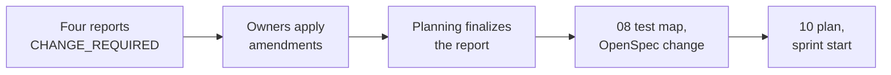

# SPRINT-004 plan v6: amendments owed, scope and decisions

This page belongs to the [plan](03.14-sprint-004-working-plan.md). Draft of 19 November 2026, replacing version 5. The amendments come from the four first-pass reports: [02](../02-purpose/03.5-sprint-004-purpose-alignment.md), [03](../03-system-model-and-use-cases/03.2-sprint-004-use-case-review.md), [04](../04-benchmarks-and-eval-strategy/03.12-sprint-004-evaluation-review.md) and [05](../05-high-level-design-and-architecture/03.5-sprint-004-architecture-review.md). The owners are applying them now; "pending" is as 00 Governance told me.

*The sprint cannot start until the amendments are applied and the report is rechecked.*

## Amendments owed (proposed by the reviewers, not applied by Planning)

| Stage | Amendments | State |
| --- | --- | --- |
| 02 | "meeting" for "interview"; outcome "review a past meeting" and the stored-record sentence; details area marked out; capabilities refreshed at closeout | Pending |
| 03 | Remove details from 01.5, 01.5.1, 01.9, 01.4; "meeting" wording; Remove and restart rules; which logs download; key corners; name the page-check state list | Pending |
| 04 | Rewrite the glance check, retire the details row; name-rule and content-type cases; bytes per hour in the live session; log-text review and local-caller limit | Pending |
| 05 | Bullets-only contract for both the reader call and the fallback answer request; keys in 01.6; the 5 MB wording; criterion wording as in plan v6 | Pending |
| 08 | AD-1 to AD-3 reissued; clock for the 10-second hold; name rule SU-3; criterion numbers of plan v6; drop any guard rule from the map | Pending |

## Exact application paths

`index.html`, `index.md`, `app.js`, `app.md`, `poc/` (including `poc/logs/` and its `.gitignore`), `openspec/changes/`. Outside: `docs/asdg/`, root `AGENTS.md`, `asdg/`, `.asdg/`, `images/`.

## If the sprint must shrink, slip in this order

0. The avatar (B-15) first, as a whole, since it is isolated; 1. the Download button (the file stays); 2. the new screen, falling back to the current one. **Never slip:** status, upload, the log file, criteria 8 to 10.

## Decisions

| Decision | State |
| --- | --- |
| 05 Q1 to Q4; 20,000 limit; files only; 08 Q1 to Q14; log in `poc/logs/`, kept until he deletes; every meeting; carry-forward; ASDG Admin 2 applies the root statement | **Decided**, relayed by 00 Governance |
| S004-GUARD (C1, C3) moves to SPRINT-005 | **Decided 19 November** |
| Purpose adds "review a past meeting" | **Decided 19 November** |
| Other people's treatment (speech stored, consent) | **Deferred** to the security work |
| B-15 Alice avatar added to SPRINT-004 | **Decided by Pablo 19 November** (relayed): on by default, explicit exception to "nothing moves", mpfb.glb; 08's rules pending |
| Acceptance of the amended documents | **Owed** by Pablo; no hash approval recorded |

Risks: a 130 KB package (his figure) cannot be uploaded whole; the log holds other people's speech; bullets shown may quote the package.

Return to the [plan](03.14-sprint-004-working-plan.md) or to [Planning](README.md).
