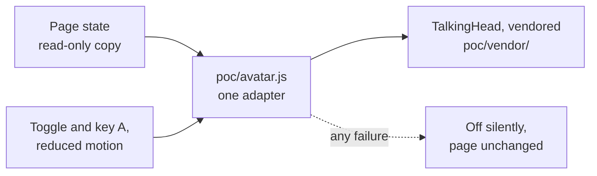

# SPRINT-004 story B-15: Alice avatar, state-driven talking head (V0)

This page belongs to the [plan](03.14-sprint-004-working-plan.md). Draft of 19 November 2026, updated with Pablo's decisions relayed by 00 Governance. The avatar is Alice as a mature professional woman, silver-white hair, glasses, friendly, using [TalkingHead](https://github.com/met4citizen/TalkingHead); the free CC0 model `mpfb.glb` comes first. **Kept small: no research or architecture exercise.** 02's [assessment](../02-purpose/03.6-avatar-purpose-assessment.md) and 05's [adapter design](../05-high-level-design-and-architecture/01.11-avatar-adapter.md) are in; 08's rules (AV-1 to AV-8) and 10's [avatar review](../10-document-review-and-release/03.5.3-sprint-004-review-avatar.md) are in. Nothing here is approved.

*The adapter only reads page state; it can be switched off, and failing never touches the page.*

## Reason (Pablo's words, relayed)

"The talking head is for now a UI feature that changes and moves with the state changes. It's one more element in the colour code, but more subtle because it may react to more things. It's just client side." So the story is a secondary state signal beside the cue colour, on the page only.

## Decisions (Pablo, 19 November, relayed)

Yes, as an **explicit exception to "nothing moves"**; **on by default** (02 advised off by default; Pablo chose on). Blinking when idle; a short expression or nod on a state change; no head movement or gestures; about 15 frames a second; paused when hidden. A visible toggle in the bar plus key A; off under reduced motion; off silently on failure. 05: vendored, pinned, committed, served through the fixed asset list, so "no backend change" becomes "no new backend behaviour". Placement (Pablo, later the same day): at the left end of the bar as a logo with a small caption, the centre left empty for a later "Alice says" area ([B-16](03.12.1-product-backlog-later.md)).

## Acceptance criteria (draft, from 08's [AV rules](../08-low-level-design/03.7.9-s004-avatar.md))

1. The avatar is a round box at the left end of the bar, like a logo, with the name "Alice Good Meetings" as a small caption under its head; it is on by default, from `mpfb.glb`. The centre of the bar stays empty, reserved for a later "Alice says" area (SA-19). Sizes are 08's (AV-1, SA-3). Its six states, idle, listening, question, researching, ready and error, use the closest built-in moods with the timings of AV-3 (AV-1 to AV-3).
2. Motion is an occasional blink when idle and one short expression or nod per state change, about 15 frames a second, stopped when the tab is hidden; no head movement, gestures, sound or speech (AV-4).
3. A visible toggle at the right end of the bar and key A switch it, remembered in the browser; under reduced motion it is off, and on any failure within 5 s it is removed silently without delaying Start or Upload (AV-5, AV-6).
4. The library, three.js and the model are vendored, pinned and committed in `poc/vendor/` with their licence files, listed in the service's fixed asset list, loaded from the page's own origin with no CDN (AV-7).
5. The adapter reads a frozen copy of page state and has no write path to the cue, timer, audio, service or log (AV-8).
6. The checks of 08's [avatar checks](../08-low-level-design/03.8.6-s004-avatar-checks.md) pass, including a forced failure and same-origin requests only; the live session reports any jank.

## Files, size and slipping

**Size:** M. **Proposed paths, all inside `poc/`** (08, 05 and 09 confirm: 05 says only "under the page's folder" and 08 only "under `poc/`"): the adapter `poc/avatar.js` with `poc/avatar.md`; one vendored folder `poc/vendor/` holding the library, three.js and `poc/vendor/avatar/mpfb.glb`; the licence record `poc/vendor/README.md`; plus small edits to `index.html` (import map, toggle), `app.js` (one hook), `poc/server.mjs` (asset list only) and the tests. The scope entries need no change. **Slip:** this story first, whole.
Return to the [plan](03.14-sprint-004-working-plan.md) or to [Planning](README.md).
