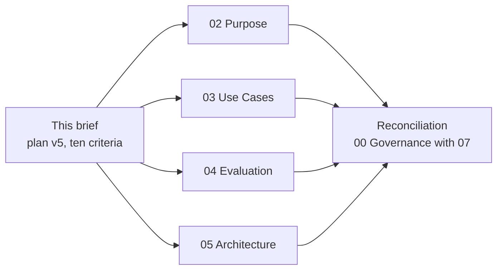

# SPRINT-004 review brief: the baseline for the first-pass reports

SPRINT-004 (proposed, not started) lets Pablo load his preparation package from the page, keep a complete local log of each meeting and download it, and work from a new screen, for use in every meeting. This is the one brief for step 2 of the sprint-align workflow. Stages 02, 03, 04 and 05 each use this same text for their own first-pass report; none sees another's new conclusions first. It is a draft by 07 Planning, 19 November 2026.

*Four independent reports from one baseline; the reconciliation follows.*

## The baseline

| Item | Value |
| --- | --- |
| Sprint | SPRINT-004 proposed; no sprint is active, so there is no `.asdg/sprint.json` snapshot. The baseline is the plan |
| Plan | [03.14](03.14-sprint-004-working-plan.md) SHA-256 `9eed53dbdbc5d0b11d60836e3a8b0f646cc331a473f4b9d6e095c3f901b9eb31`; [03.14.1](03.14.1-sprint-004-documents-and-decisions.md) `f17b738378f80d926564f857db0c9136b4908b3ca88cd35b798bf440373e6e20` |
| Git | Branch `sprint-03`, HEAD `7d06df187a041a65b646d8d573acbbc2eeea0c87`, plus uncommitted drafts of 02, 03, 04, 05, 08 and 12 as they stood on 19 November; their hashes are on the source pages |
| Objective (draft) | "Let Pablo load his package from the page, see what is loaded, work from the new screen, and keep a complete local log of each meeting that he can download." |
| Scope (draft) | `index.html`, `index.md`, `app.js`, `app.md`, `poc/` (with `poc/logs/`), `openspec/changes/`; not `docs/asdg/`, root `AGENTS.md`, `asdg/`, `.asdg/`, `images/` |

## Commitments

| ID | Commitment | Plan criterion |
| --- | --- | --- |
| S004-STATUS | Before Start and after a reload the page shows what package is loaded; `GET /package` returns it without package text | 1 |
| S004-UPLOAD | Several `.md` or `.txt` files replace the package, in memory only; limits, Remove, failures keep the old package; none while listening; the package survives Stop | 2 |
| S004-LOG | A time-stamped log of each listening session, including other people's speech and the bullets shown, written as it goes to Git-ignored `poc/logs/`; no package files in it; Alice deletes nothing | 3 |
| S004-DOWNLOAD | The Download log button saves the current or last session's file; local callers only | 4 |
| S004-SCREEN | The 08 screen design: slim bar, big question, candidate line, "Alice suggests" and "What I hear", three bullets; no details requested; "no new question heard" | 5 and part of 6 |
| S004-CUE | Keys G, L, S set the cue and hold for 10 seconds; Esc clears; every existing input stays | 6 |
| S004-GUARD | Conditional: an idle pause sends no request, and print shows the post-pause request and hint | 7 |
| S004-STATEMENTS | The root `AGENTS.md` and `poc/README.md` statements match upload, the log, its place and retention; 50 nonblank lines | 9 |
| S004-CARRY | Carry-forward from SPRINT-003: wording of an answer after a pause, Confirm optional, what is sent where; tests, page check and `bash poc/alice-run.sh` re-run; recorded live session; independent 10 review | 8, 9, 10 |

Direction and constraints are on [03.15.1](03.15.1-sprint-004-brief-direction.md). Sources and hashes: [shared, 02 and 03](03.15.2-sprint-004-brief-sources.md), [04, 05, 08 and 12](03.15.3-sprint-004-brief-sources-04-12.md).

## What each stage returns

Save one report in your own stage folder and return its link. The first pass is read-only: propose amendments, do not apply them. State this baseline, the IDs you cover, and the sources and hashes you relied on. Name missing, contradictory or ambiguous content, and each required amendment or an evidenced no-change conclusion, with the effect on later stages. Technical commitments (S004-GUARD, S004-STATEMENTS, S004-CARRY) trace to an existing workflow, quality need or operating rule, not a new feature. Pages are drafts with no recorded acceptance. End with one verdict: `ALIGNED`, `CHANGE_REQUIRED`, `NEEDS_DECISION` or `MISSING_EVIDENCE`.
