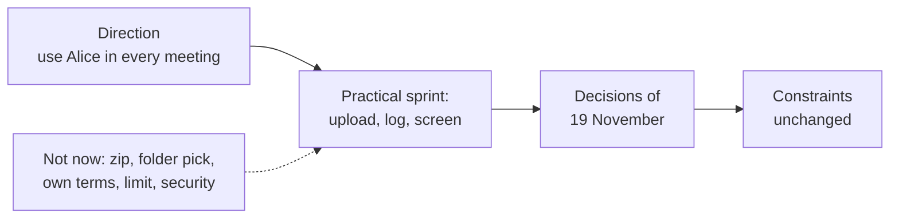

# SPRINT-004 brief: direction, decisions and constraints

This page belongs to the [SPRINT-004 review brief](03.15-sprint-004-review-brief.md). Pablo's decisions reached 07 Planning only as relays from 00 Governance; none carries a hash approval of any document. Draft of 19 November 2026.

*His direction chose the sprint; the decisions fixed its details; the constraints still bind it.*

## Pablo's direction (relayed)

He wants to use Alice in every meeting, so the sprint takes the most practical stories: uploading the preparation package from the page, a complete local meeting log with a Download log button, and a new screen. He has no more UI ideas now; later ones go to the SPRINT-005 backlog. Scope is every meeting, not interviews first.

## Decisions of 19 November 2026

- **Package (05 Q1 to Q4):** kept after Stop; an upload replaces the folder package; own terms (B-03) remembered but moot until SPRINT-005; this is the later sprint. The 20,000-character limit holds; files only, no folder pick, no zip.
- **Screen (08 Q1 to Q13):** keys G, L, S set the cue with nothing on screen; a small cue word in the bar; three bullets; Esc clears; a small Remove in the package line; no hide control for the monitor; one log per listening session; bullets shown are logged; Focus and Live cards become the question and candidate line; the model is no longer asked for details; "newest words" per item; right column "What I hear"; the mockup's departures accepted.
- **Cue (Q14):** a manual key holds for 10 seconds, then the timer resumes.
- **Log:** inside the project in Git-ignored `poc/logs/` because this copy is not synced to Google Drive; a setting may move it later. Kept until he deletes the files; it keeps other people's speech, local only.
- **Other:** ASDG Admin 2 applies the root `AGENTS.md` statement. B-06 C1 and C3 are in only if 08 sizes them cheap.

## Constraints that still bind

- Preserve his attention: brief, glanceable visual cues; spoken coaching interrupted his thinking ([Purpose](../02-purpose/01-purpose.md)).
- Keep every input tool and add, never remove (his rule of 18 November).
- The key lives only in `poc/.env.local`; microphone audio and selected text go to OpenAI while listening; the log never goes there.
- No analysis component may use future audio, private transcripts or reference answers; `eval-data/` is not live input.
- A sprint starts only with a clean worktree, a new branch and a human command; root `AGENTS.md` stays within 50 nonblank lines.

## Known tensions to examine

1. 05's last update may reduce what refuses to log when not Git-ignored. 2. The log holds private speech of other people. 3. The package of about 130 KB (his figure) exceeds the limit. 4. Q14 changes the SPRINT-003 timer behavior, not only a page. 5. SPRINT-003 closed unfinished, so its carry-forward items are criteria here.
