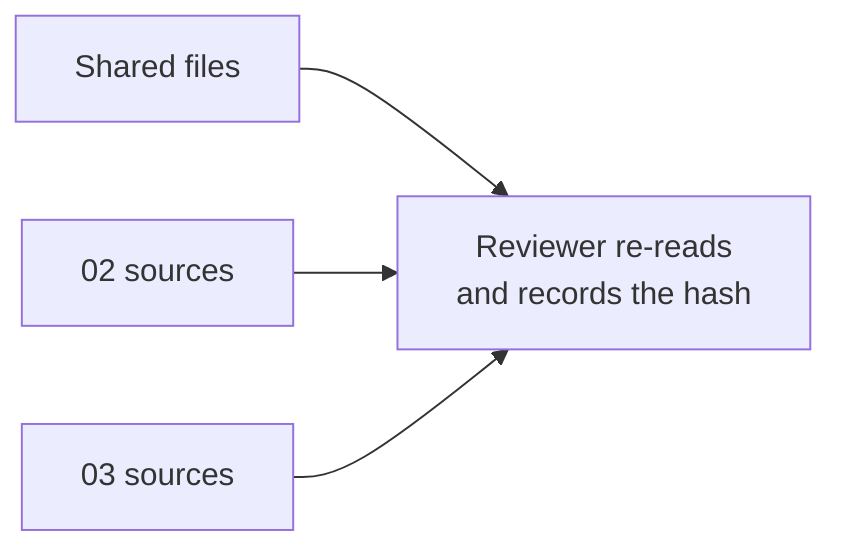

# SPRINT-004 brief: sources and hashes, shared, 02 and 03

This page belongs to the [SPRINT-004 review brief](03.15-sprint-004-review-brief.md). Each hash is the first and last eight characters of the SHA-256 of the file on 19 November 2026. Files marked draft are uncommitted and may change; the reviewer records the hash it actually read. "Pending" marks a page its owner is still updating.

*Cite what you read with its hash; a changed hash means a changed page.*

| Path | Hash | State |
| --- | --- | --- |
| `AGENTS.md` | `09af6e17…ec8d99a2` | Committed; protected control target |
| `README.md` | `4756f6f4…6d0abc93` | Committed |
| `poc/README.md` | `986dd421…f268f623` | Committed |
| `.asdg/sprint-closeouts/2a86c4ec-8893-44d0-9f2b-ae1bd47f2d64.json` | `14da691c…e17b2b1e` | SPRINT-003 closeout receipt, unfinished |
| [03.12 backlog](03.12-product-backlog.md) | `267c612c…9b399ad0` | Draft |
| [03.12.1 later stories](03.12.1-product-backlog-later.md) | `31622491…1f2ecfc9` | Draft |
| [03.13.1 closeout needs](03.13.1-sprint-004-option-b-and-closeout.md) | `5ad2de3d…075f475d` | Draft |
| [02 purpose](../02-purpose/01-purpose.md) | `fcc0d8b9…3bc310b3` | Committed |
| [02 current capabilities](../02-purpose/02-current-capabilities.md) | `046f50f0…7f11924f` | Uncommitted edit |
| [02 planned improvements](../02-purpose/03-planned-improvements.md) | `19a2b0c2…a6b6824d` | Uncommitted edit |
| [02 record and upload boundary](../02-purpose/03.4-sprint-004-record-and-upload-boundary.md) | `afabdb05…fd4014ab` | Draft, pending the log-place change |
| [03 system model](../03-system-model-and-use-cases/01-system-model.md) | `ede3d953…10143f30` | Uncommitted edit |
| [03 input channels](../03-system-model-and-use-cases/01.6-inputs-and-future-channels.md) | `8472b1c7…36d305e2` | Uncommitted edit |
| [03 UC-07 package](../03-system-model-and-use-cases/01.7-load-preparation-package.md) | `d0992c08…86e79566` | Uncommitted edit |
| [03 UC-08 log](../03-system-model-and-use-cases/01.8-meeting-log-and-download.md) | `546d51a1…0bfecae1` | Draft, pending |
| [03 new screen](../03-system-model-and-use-cases/01.9-new-screen.md) | `0e3b3ca3…6658676d` | Draft |

The earlier SPRINT-003 reviews are history and are not cited here; the [reconciliation of SPRINT-003](03.10-sprint-003-alignment-report-v4.md) shows how they were used.
Next: [04, 05, 08 and 12](03.15.3-sprint-004-brief-sources-04-12.md). Return to the [brief](03.15-sprint-004-review-brief.md).
