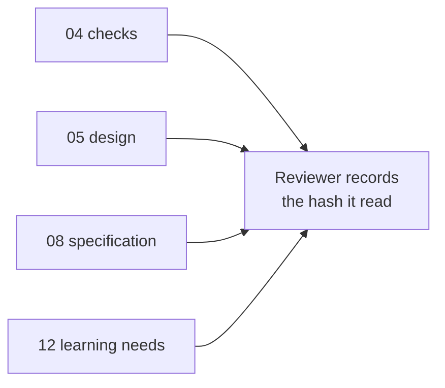

# SPRINT-004 brief: sources and hashes, 04, 05, 08 and 12

This page belongs to the [SPRINT-004 review brief](03.15-sprint-004-review-brief.md). Hashes are the first and last eight characters of the SHA-256 on 19 November 2026. 05 is making one last small update (no refusal to log when not Git-ignored; no exclude rule), so its two log pages will change; record the hash you read.

*08 and 12 are evidence for the four reviewers but do not write a first report.*

| Path | Hash | State |
| --- | --- | --- |
| [04 evaluation strategy](../04-benchmarks-and-eval-strategy/01-evaluation-strategy.md) | `46b4a812…3c0edd52` | Committed |
| [04 03.9 automatic flow](../04-benchmarks-and-eval-strategy/03.9-sprint-003-automatic-flow-and-channels.md) | `d6e9a213…ab8e6daa` | Committed |
| [04 03.10 upload, log, screen checks](../04-benchmarks-and-eval-strategy/03.10-sprint-004-upload-log-and-screen-checks.md) | `02fef0fb…8b96e867` | Draft, pending the log-place change |
| [04 03.11 live session and statements](../04-benchmarks-and-eval-strategy/03.11-sprint-004-live-session-and-statement-check.md) | `9140044c…1dca2336` | Draft, pending |
| [05 architecture](../05-high-level-design-and-architecture/01-architecture.md) | `1acac27d…487d0c4e` | Committed |
| [05 01.7 automatic flow](../05-high-level-design-and-architecture/01.7-automatic-question-flow.md) | `f1daf54e…30a6b485` | Committed |
| [05 01.8 upload and vocabulary](../05-high-level-design-and-architecture/01.8-package-upload-and-vocabulary.md) | `c6550c1a…ad5df050` | Uncommitted edit |
| [05 01.8.1 limits and statements](../05-high-level-design-and-architecture/01.8.1-upload-limits-and-statements.md) | `fca360b1…79ac691a` | Uncommitted edit |
| [05 01.9 SPRINT-004 review](../05-high-level-design-and-architecture/01.9-sprint-004-architecture-review.md) | `cb72de74…5aaf4c33` | Draft |
| [05 01.10 log and transcript message](../05-high-level-design-and-architecture/01.10-meeting-log-and-transcript-message.md) | `d841546f…5b89fbd7` | Draft, pending |
| [05 01.10.1 statements](../05-high-level-design-and-architecture/01.10.1-upload-and-log-statements.md) | `a9638182…0f32e3d4` | Draft, pending |
| [05 current architecture](../05-high-level-design-and-architecture/02-current-architecture.md) | `f69d7574…91eebef9` | Committed |
| [05 03.4 code assessment](../05-high-level-design-and-architecture/03.4-18-november-code-assessment.md) | `4fbc2a46…14230a6b` | Committed |
| [08 screen specification](../08-low-level-design/03.7-sprint-004-screen-specification.md) | `eb8741b0…7e7a0343` | Draft; sub-pages 03.7.1 to 03.7.8 |
| [08 decision record Q1 to Q14](../08-low-level-design/03.7.7-s004-open-questions.md) | `72c3c228…1ca27b68` | Draft, pending the log-place change |
| [08 test map](../08-low-level-design/03.8-sprint-004-test-map.md) | `d0641506…dbb12771` | Draft; sub-pages 03.8.1 to 03.8.4 |
| [08 mockup](../08-low-level-design/images/s004-alice-ui-v2-mockup.png) | not hashed | Draft image |
| [12 meeting log learning needs](../12-observability-insights-and-learning/01-meeting-log-learning-needs.md) | `6f332f71…78c49bcd` | Draft |

06 has only the SPRINT-003 POC decision; no SPRINT-004 uncertainty is framed for it yet.
Return to the [brief](03.15-sprint-004-review-brief.md) or to [Planning](README.md).
