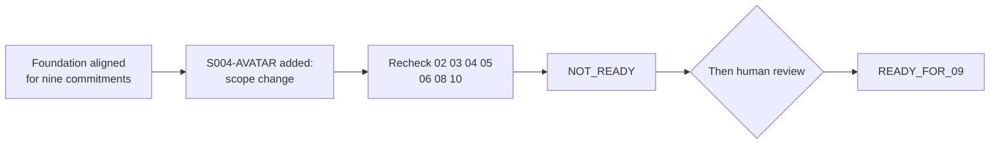

# SPRINT-004 alignment and readiness report, version 7

This is 07 Planning's report on the proposed SPRINT-004 (Alice.Good.Meetings), a draft of 19 November 2026, rechecked after every owner closed the open items of version 2, then amended for the avatar story B-15 that Pablo added. It replaces version 6 (same file) and grants no approval, starts no work and changes no state. **No document of this sprint carries a recorded approval or hash acceptance.**

*The nine earlier commitments were ready for review; the added avatar story reopens five stages before Pablo is asked.*

## Identity and direction

| Item | Value |
| --- | --- |
| Sprint | SPRINT-004, proposed; none active, so no snapshot; `check-implementation` answers "no active sprint" |
| Baseline | [Brief](03.15-sprint-004-review-brief.md) `f287d715…ac949d9a`; Git `7d06df187a041a65b646d8d573acbbc2eeea0c87`, branch `sprint-03`; 71 documents and the OpenSpec change uncommitted |
| Assessed | [Plan v6](03.14-sprint-004-working-plan.md) `5bea9e62…150b6211`, [03.14.1](03.14.1-sprint-004-documents-and-decisions.md) `c7561fb3…b55f1cca`, [task list](03.17-sprint-004-task-list.md) `b2b8b41b…fd05ab3d`, 19 November 2026 |
| Direction (relayed by 00 Governance) | Alice in every meeting; guard to SPRINT-005; outcome "review a past meeting"; others' speech waits for security; "all sounds good, finalize the plan". These are decisions on questions, not acceptance of documents |

## Rechecked today

All six relationships hold for the nine earlier commitments. Counts recounted: 08 has 91 rules and 106 checks; the OpenSpec change validates under `--strict` and section 7 is labelled S004-AVATAR as are the AV rules; 05's 01.11, 08 and the OpenSpec tasks name the same `poc/vendor/`, `poc/avatar.js` and `poc/avatar.md`; 06's amended decision (`4aa4d2f7…`) keeps "no POC" with the draw loop; 04's 03.10 (`44b339b4…`) maps its avatar checks to 08. 81 changed documents are within 50 nonblank lines with working links, except Governance's presentation outline. Plan v7 and the avatar page carry the logo placement and the reserved centre; B-16 holds the "Alice says" area as a later story.

## Result: `NOT_READY`

**Exact remaining work (two stale numbers, no decision):** 03's UC-09 avatar row and 04's 03.10 check A1 still say the avatar is 44 px; 08 now sets a 56 px logo in an 80 px bar with a caption and an empty centre (AV-1, SA-3, SA-19). 03 and 04 correct them, and 03 mentions the reserved centre. The rule is that no contradiction may remain.
Then the one choice for Pablo is to accept the SPRINT-004 documents by hash, and the result becomes `READY_FOR_09`. **No document has an approval recorded.**
Coverage is on [03.16.1](03.16.1-sprint-004-coverage.md); scope, approvals and freshness on [03.16.3](03.16.3-sprint-004-scope-and-approvals.md). Return to [Planning](README.md).
