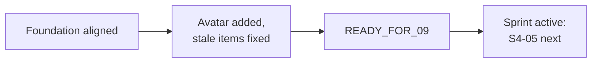

# SPRINT-004 alignment and readiness report, version 8

This is 07 Planning's report on the proposed SPRINT-004 (Alice.Good.Meetings), a draft of 19 November 2026, rechecked after every owner closed its items, the avatar story B-15 was added, and Pablo started the sprint. It replaces version 7 (same file) and grants no approval, starts no work and changes no state. **No document of this sprint carries a recorded approval or hash acceptance.**

*The avatar reopened five stages; their corrections are in, so the documents are ready for 09 under the sprint gate.*

## Identity and direction

| Item | Value |
| --- | --- |
| Sprint | SPRINT-004, **active** on branch `sprint-04` (observed 20 November 2026): `.asdg/sprint.json` holds the objective, the six scope entries and 11 criteria from plan v7; `check-implementation` answers "Implementation allowed" for `poc/server.mjs` |
| Baseline | [Brief](03.15-sprint-004-review-brief.md) `f287d715…ac949d9a`; Git `ac01aaf`, worktree clean but for `.asdg/sprint.json` |
| Assessed | [Plan v7](03.14-sprint-004-working-plan.md) `b17a92b1…cc30f4`, [03.14.1](03.14.1-sprint-004-documents-and-decisions.md) `c25a106d…47c598c`, [avatar page](03.14.2-sprint-004-avatar-story.md) `ff0f9e39…db055589`, [task list](03.17-sprint-004-task-list.md) `b2b8b41b…fd05ab3d`, unchanged since they were committed |
| Direction (relayed) | Every decision of 19 and 20 November via 00 Governance, and Pablo's own `/asdg-sprint-align` and sprint start |

## Rechecked today

The two stale "44 px" items are fixed: UC-09's avatar row names the 56 px logo with its caption and the reserved centre, and 04's check A1 follows 08's size and place; "44 px" now appears only in my older report text. 08 has 91 rules and 106 checks (recounted); the OpenSpec change validates under `--strict`; all 81 documents of the sprint are within 50 nonblank lines with working links and are committed. The six relationships hold, and no contradiction or open item remains from versions 2 to 7. 06's amended no-POC decision (`4aa4d2f7…`), 10's review pages and 04's `44b339b4…` mapping are in.

## Result: `READY_FOR_09`

For the documents, readiness holds: every commitment, including S004-AVATAR, has reason, scenario, check, design, decision, rule and task. **Plainly: no SPRINT-004 document has an approval or hash acceptance recorded** (`.asdg/document-reviews.json` holds none for these pages). Readiness rests on Pablo's decisions, relayed by 00 Governance, and on his own start of the sprint after this alignment, as on 18 November for SPRINT-003. Task S4-01 (acceptance by hash) remains open if he wants it; S4-03 and S4-04 are observed done; S4-05 (09 confirms the scope list) is next. 09 still verifies role, sprint and path for each edit. The plan and task list keep their pre-start wording ("no sprint is active") because their bytes are the sprint baseline.
Coverage is on [03.16.1](03.16.1-sprint-004-coverage.md); scope, approvals and freshness on [03.16.3](03.16.3-sprint-004-scope-and-approvals.md). Return to [Planning](README.md).
