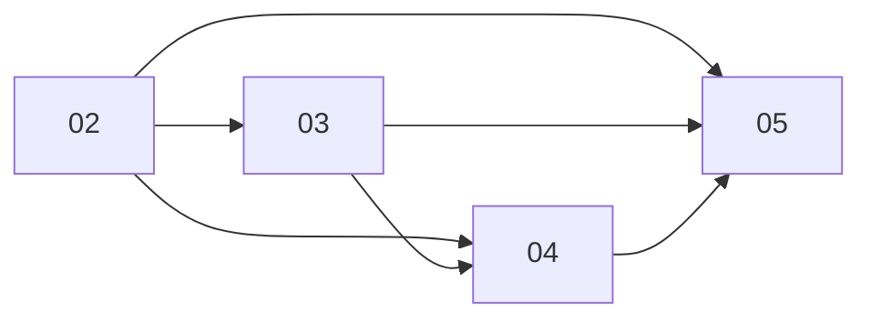

# SPRINT-004 report: relationships, conflicts and the stage 06 note

This page belongs to the [alignment report](03.16-sprint-004-alignment-report.md). Final draft of 19 November 2026, judged on meaning in the amended pages, not on matching words. Nothing was run; no code was opened.

*All six relationships hold; the earlier gaps are closed.*

| Relationship | Status | Evidence and what remains |
| --- | --- | --- |
| Purpose → Use Cases | Holds | Outcome "review a past meeting" in 01-purpose; UC-08, UC-09; "other meeting types" sentence in 03 present |
| Purpose → Evaluation | Holds | 04's 01.2 retires the details row and rewrites the glance check; 03.11 reviews the log |
| Purpose → Architecture | Holds | Guard out; others' speech deferred; log boundary in 03.4 and 01.10 |
| Use Cases → Evaluation | Holds | Key corners, Remove, restart now in 03; checks follow in 03.10 |
| Use Cases → Architecture | Holds | UC-08 no longer promises a status line; Git ignore alone, as 05 decided |
| Evaluation → Architecture | Holds | Both calls bullets-only (AD-1 to AD-3); a controllable clock in PC4-46; 5 MB in 01.10; one name rule in 05 and 08 |

## Conflicts and open items

None open. Closed since version 2: the "meeting" sentence (03), the Git-ignore row (03), the name rule (05, 08), the plan v6 labels (08), the length of 12's page and 12's asks (05 decided; 08 ML-14, ML-15). Left as history, not blocking: capabilities and planned-improvements still describe the SPRINT-003 build and details (02, refresh at closeout).

## Stage 06

06 decided: [no new POC](../06-viable-proof-of-concept/03.2-sprint-004-poc-decision.md) `7251b045…361c3029`, with three uncertainties settled by an existing test or the live session, and three send-back triggers (S4-12, S4-34). Planning agrees; this is 06's decision, recorded as a draft with no approval.
Return to the [report](03.16-sprint-004-alignment-report.md) or to [Planning](README.md).
