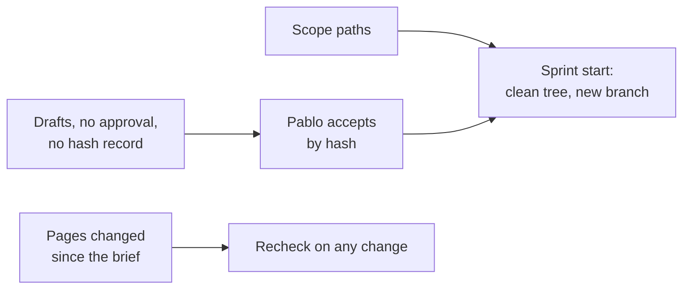

# SPRINT-004 report: scope, approvals and freshness

This page belongs to the [alignment report](03.16-sprint-004-alignment-report.md). Version 4, 19 November 2026; it approves nothing.

*Scope and approval are separate; the sprint starts only with both.*

## Scope paths for sprint start (plan v7, 08's rules, the OpenSpec change)

Six entries, unchanged by the avatar: `index.html`, `index.md`, `app.js`, `app.md`, `poc/`, `openspec/changes/`. Inside `poc/`: `poc/logs/` with its `.gitignore`, `poc/README.md`, `poc/poc.test.mjs`, `poc/browser-protocol.mjs`, the avatar adapter `poc/avatar.js` with `poc/avatar.md`, the vendored folder `poc/vendor/` (library, three.js, `mpfb.glb`, each with its licence file) and the asset-list edit in `poc/server.mjs`. The service, session, agent and package-loader sources and their `.md` companions follow from 08's rules; 09 confirms the list in S4-05; 05, 08 and the OpenSpec change agree on the avatar names. Outside: `docs/asdg/`, root `AGENTS.md` (ASDG Admin 2, 45 of 50 lines), `asdg/`, `.asdg/`, `images/`. The change `sprint-004-upload-log-and-screen` is valid and untracked.

## Approvals: stated plainly

**No document of SPRINT-004 has a recorded approval or hash acceptance**: not the plan, the task list, the brief, the first reports, 02's, 03's, 04's, 05's, 06's, 08's or 10's pages, the OpenSpec change, the mockup, nor 12's. Pablo's answers are relays from 00 Governance and cover decisions, not document acceptance. 05's positions on 12's asks are marked "proposed until he accepts them". A passing `openspec validate --strict` is not acceptance.

## Remaining human steps

Pablo accepts by hash (S4-01); 00 Governance records the result; Pablo commits and starts the sprint. 10 notes that `check-implementation` was "blocked by the missing `asdg-pre-code-review` integration"; I observed only "no active sprint" today, and the skill is present in the project, so Planning cannot confirm 10's reading.

## Scope change: the avatar (B-15), state of each stage

| Stage | Avatar input | State |
| --- | --- | --- |
| 02 | [03.6](../02-purpose/03.6-avatar-purpose-assessment.md): Pablo's exception, on by default, his rationale | In |
| 03 | UC-09: avatar row, key A, toggle | In; says 44 px, stale |
| 04 | A1 to A5 mapped to 08's AV rules (03.10 `44b339b4…`) | In; A1 says 44 px, stale |
| 05 | 01.11: vendored, pinned, fixed asset list, `poc/vendor/` | In |
| 06 | Amended decision, `4aa4d2f7…`: no POC with the draw loop | In |
| 08 | AV-1 to AV-8, SA-19 | In: 91 rules, 106 checks, S004-AVATAR labels, logo placement |
| 10 | [Avatar review](../10-document-review-and-release/03.5.3-sprint-004-review-avatar.md) | In |

## Freshness

Amended pages were reread today: 02's `01-purpose`, 03's UC-07 to UC-09 and README, 04's 01.2 and 03.10 to 03.12, 05's 01.8.1, 01.10 and 01.10.1, 08's `03.7` `498dcb1d…e34b3b9c` and `03.8` `b133f552…dbe467d1`, the OpenSpec tasks `e9cd4be5…f83768ef`. Any change to these invalidates the coverage it feeds. The first-pass reports keep their bytes.
Return to the [report](03.16-sprint-004-alignment-report.md) or to [Planning](README.md).
