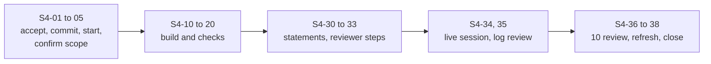

# SPRINT-004 task list: from aligned foundation to a finished sprint

This is the single authoritative task list for SPRINT-004 (Alice.Good.Meetings), written by 07 Planning on 19 November 2026 after the foundation was aligned in the [alignment report](03.16-sprint-004-alignment-report.md). It is a proposal: it starts no task and approves nothing. **No document it lists carries a recorded approval or hash acceptance.** Each task cites its OpenSpec task and 08 rules, and the commitment IDs of the [brief](03.15-sprint-004-review-brief.md).

*Documents and a human start come first; the live session needs every check done; review and closeout end it.*

## Rules this list keeps

- **One list.** The [build tasks](03.17.1-sprint-004-build-tasks.md) and the [checks, reviews and closeout](03.17.2-sprint-004-checks-and-closeout.md) follow. The OpenSpec change [`sprint-004-upload-log-and-screen`](../../../openspec/changes/sprint-004-upload-log-and-screen/tasks.md) owns the implementation tasks 1.1 to 6.2; this list orders and links them and never copies them.
- **Owners keep their authority.** Pablo alone starts the sprint, commits and closes it. Every application edit needs the active sprint and a passing `sprint check-implementation` for its path; today it answers "no active sprint".
- **Never slip:** status, upload, the log file, criteria 8 to 10. **Slip order if needed:** the Download button, then the new screen.

## Documents that must exist before coding

All exist as drafts. Hashes are not recorded here; the report lists the state.

| Stage | Document | Owner |
| --- | --- | --- |
| 02, 03, 04, 05 | Purpose, UC-07 to UC-09, 04's 03.10 to 03.12, 05's 01.8 to 01.10.1 | those stages |
| 06 | [No-POC decision](../06-viable-proof-of-concept/03.2-sprint-004-poc-decision.md) | 06 |
| 08 | [Specification 03.7](../08-low-level-design/03.7-sprint-004-screen-specification.md), [test map 03.8](../08-low-level-design/03.8-sprint-004-test-map.md), the OpenSpec change | 08 |
| 10 | [Review plan 03.5](../10-document-review-and-release/03.5-sprint-004-review-plan.md) | 10 |

## Before coding

| ID | Task | Owner | Needs | Done when |
| --- | --- | --- | --- | --- |
| S4-01 | Review and accept, change or reject the SPRINT-004 documents above and the plan, with the mockup, through the pre-code review if wanted | Pablo | none | A dated decision naming each by hash |
| S4-02 | Record `READY_FOR_09` or the reason it is not | 00 Governance | S4-01 | A recorded result |
| S4-03 | Commit the documents and the OpenSpec change so the worktree is clean | Pablo | S4-01 | `git status` clean |
| S4-04 | Start the sprint with plan v6's objective, scope and ten criteria; a new branch is made | Pablo | S4-02, S4-03 | `.asdg/sprint.json` holds them |
| S4-05 | Confirm the scope list: the `poc/` files to change against 08's rules, each passing `check-implementation` | 09 Coding | S4-04 | A recorded list |
