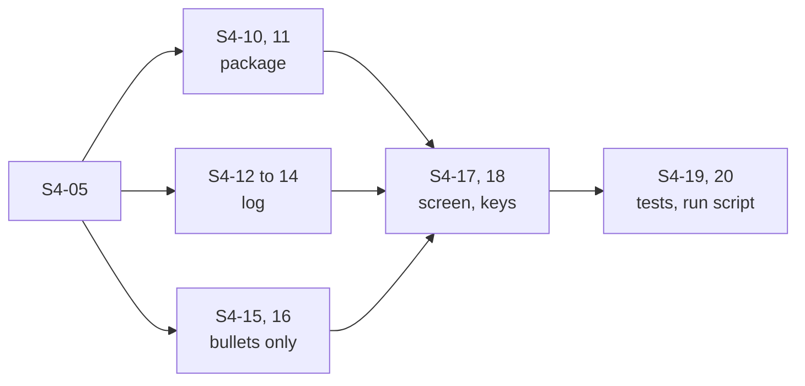

# SPRINT-004 task list: build tasks

This page belongs to the [task list](03.17-sprint-004-task-list.md). Nothing here starts before S4-05. Owner is 09 Coding. "OT" is the task in the OpenSpec change; rules and checks are 08's ([specification](../08-low-level-design/03.7-sprint-004-screen-specification.md), [test map](../08-low-level-design/03.8-sprint-004-test-map.md)). The tests for each task are written with it, then run as one in S4-19. Draft of 19 November 2026.

*Package, log and bullets-only are three service strands that share `poc/server.mjs`, so one builder takes them in turn; the page waits for all three.*

| ID | Task | Commitment | OT | 08 rules | Done when |
| --- | --- | --- | --- | --- | --- |
| S4-10 | `GET`, `PUT`, `DELETE /package` with every refusal and the name rule of 05 | STATUS, UPLOAD | 1.1 | SU-3 to SU-10 | ST4-01 to 08, 29, 35 to 37, 40 pass |
| S4-11 | Package kept after Stop, in memory only, snapshot at Start | UPLOAD | 1.2 | SU-7, SU-9 | ST4-06, 07 pass; no sentinel in log, audit or frame |
| S4-12 | One append-only log writer, header, two clocks, all events; no cue events; never awaited on the audio path | LOG | 2.1 | ML-1 to ML-15 | ST4-12 to 23, 41, 42 pass; a slow or failing writer stops no packet |
| S4-13 | `poc/logs/` with its `.gitignore`, `ALICE_LOG_DIR`, modes, 5 MB cap, no deletion | LOG | 2.2 | MS-1 to MS-9, ML-13 | ST4-24 to 30, 34 pass; SH4-1 confirms ignored |
| S4-14 | `GET /log`, headers, 404, caller checks | DOWNLOAD | 2.3 | SD-1, SD-3, SD-4 | ST4-08 to 10 pass |
| S4-15 | `details` out of both schemas, the fallback result and the `proposed` message | SCREEN | 3.1 | AD-1 to AD-4 | ST4-31 to 33, 38, 39 pass |
| S4-16 | `transcript` message as a whole replacing snapshot with items | SCREEN | 3.2 | SA-17 | ST4-11 passes |
| S4-17 | New `index.html` and `app.js` with `index.md` and `app.md` | SCREEN, MEETING | 4.1 | SA-1 to SA-18, SS-1 to SS-10 | PC4-01 to 26 and 49 pass at three sizes |
| S4-18 | Keys G, L, S with the 10-second hold on the page clock, Esc, Upload, Remove, Download | CUE, UPLOAD | 4.2 | SC-1 to SC-11, SS-11, SU-1 to SU-8 | PC4-27 to 48 pass |
| S4-19 | All cases in `poc/poc.test.mjs` and `poc/browser-protocol.mjs` with companions | all | 5.1 | test map | `node --test` exits 0, existing cases pass, none calls OpenAI; page check reported apart |
| S4-20 | Run `bash poc/alice-run.sh` and the shell steps | CARRY | 5.2 | SH4 steps | Each outcome recorded separately |
| S4-21 | Vendor and pin the library, three.js and `mpfb.glb` in `poc/vendor/` with licence files; add them to the fixed asset list in `poc/server.mjs`; load through a separate adapter | AVATAR | 7.1 | AV-7 | ST4-43 and SH4-3 pass; same-origin requests only (PC4-58) |
| S4-22 | The adapter `poc/avatar.js`: six states and timings, motion at about 15 fps, toggle, key A, reduced motion, silent failure, isolation | AVATAR | 7.2 | AV-1 to AV-6, AV-8 | PC4-50 to 57 and 59 pass |

**S4-21 and S4-22 are built last, after S4-18 and before the final run of S4-19 and S4-20, and they slip first**: if the avatar slips, its cases leave S4-19 and S4-20 runs without them. S4-10 to S4-16 may overlap only on different files; `poc/server.mjs` is shared, so they run in the order above. Return to the [task list](03.17-sprint-004-task-list.md) or to [Planning](README.md).
