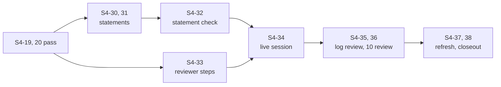

# SPRINT-004 task list: checks, reviews and closeout

This page belongs to the [task list](03.17-sprint-004-task-list.md). Nothing here starts before S4-19 and S4-20 pass. Draft of 19 November 2026; no document it names carries a recorded approval.

*Statements follow the shipped behavior, not the plan; the live session needs both checks.*

| ID | Task | Owner | Needs | Commitment | Done when |
| --- | --- | --- | --- | --- | --- |
| S4-30 | Apply the root `AGENTS.md` statements within five lines (45 of 50 used), wording matching the built behavior and saying "meeting" | ASDG Admin 2 (OT 6.1) | S4-19 | STATEMENTS, MEETING | File within 50 nonblank lines |
| S4-31 | Apply the `poc/README.md` statements, inside the sprint gate | 09 | S4-19 | STATEMENTS | Matches the code |
| S4-32 | Statement check: every sentence against the request and storage facts | 04 | S4-30, S4-31 | STATEMENTS | SH4-2 passes |
| S4-33 | Reviewer steps before any billable run: package check, canary scan, log counts | 04, run locally; 10 reviews | S4-19 | LOG, UPLOAD | No benchmark material; counts only (OT 6.2) |
| S4-34 | One live session with an uploaded package and a downloaded log; bytes per hour and the three 06 triggers reported | Pablo | S4-20, S4-32, S4-33 | all | Pass or fail by 04's rule |
| S4-35 | Review the downloaded log, yes or no per item | Pablo | S4-34 | LOG | Recorded answers |
| S4-36 | Review the exact revision against the ten criteria and 10's nine blocks | 10 ReviewQA | S4-34, S4-35 | all | A review record |
| S4-37 | Refresh the current-state pages: 02 capabilities, 05 current architecture, 04 results | 02, 05, 04 | S4-36 | all | Pages cite the built revision |
| S4-38 | Sprint review, then closeout; put the SPRINT-005 candidates in the backlog | Pablo, via 00 | S4-36 | all | His decision; no command here |

**Carried to SPRINT-005:** the idle-pause guard (C1, C3), own terms, zip, the package limit, cue events, review tooling, new UI ideas, and how other people's speech is treated.
Return to the [task list](03.17-sprint-004-task-list.md) or to [Planning](README.md).
