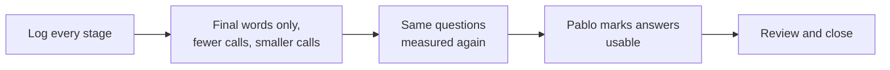

# SPRINT-005 plan: a faster Alice, measured

This is a draft of 07 Planning, 22 November 2026, from Pablo's direction relayed by 00 Governance: "try to be faster and more efficient", "without local LLM or anything special". Nothing is approved. SPRINT-004 is active and Pablo will close it first; this sprint then needs a clean worktree, a new branch and his start command. Target: a measured improvement, closed the same day.

*Measure first, change cheaply, measure the same questions again, and judge quality beside speed.*

## Draft sprint record

**Theme:** Alice answers sooner, for less.
**Objective (draft):** *Cut the time from the end of Pablo's speech to the Question and bullets on screen, and the model calls that show nothing, with cheap fixes only, and prove it on the same live questions.*
**Baseline (09's analysis, relayed):** 7 live questions, mean 8.6 s, never under 6.4 s; 16 of 23 model calls showed nothing.
**Scope (proposed):** `poc/` and `openspec/changes/`; `index.html`, `app.js` and their companions only if a log field needs the page. **Out:** local models, the two-lane redesign, new UI.

## Acceptance criteria (draft)

1. The reader is called on final words only, never on partial text; a fixture shows no call before the final transcript. (B-18, RT-1)
2. Calls that produce nothing shown fall measurably on the same list: 09 estimates about half of 16 of 23; 04 sets the threshold.
3. Each call carries less (reply fields dropped, package first); tokens and cached tokens per call are logged and lower. Only if the measurement shows a gain.
4. The same ten or so questions, each three times, are measured before and after: median and worst time to the Question and to the first bullets. 09 estimates about 6 s from 8.6 s; 04 sets the pass rule.
5. Pablo marks each answer usable or not; speed bought with worse answers fails.
6. Stop loses no untranscribed speech. The idle-pause guard (B-19) is in only if criterion 2 shows it helps.

## Owners and documents before coding

| Owner | Work |
| --- | --- |
| 09 Coding | The changes and the stage timing log; already has the analysis |
| 04 Benchmarks | The question list, the method and the pass rule |
| 08 Detailed Design | Log fields and rules RT-1 to RT-7 for the chosen steps |
| 05 Architecture | Confirm partial-text and Stop findings; data statements if what is sent changes |
| 10 ReviewQA, Pablo | Review; the live questions and his marks |

A same-day close is possible only if the documents stay small; the sprint-align round is not skipped. Return to [Planning](README.md).
