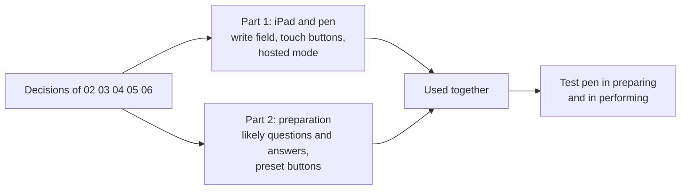

# SPRINT-006 outline: the iPad with pen, and prepared answers

This is an outline of 07 Planning, 22 November 2026, from Pablo's direction relayed by 00 Governance, hoped for the evening of the same day for his Monday meetings. **He wants both parts in one sprint.** It is not a plan: it names what each stage must decide first. Nothing is approved, and no sprint is started.

*The two parts meet at the buttons and the writing field, used in both preparing and performing.*

## What he asked for, in his words

**Part 1, iPad and pen:** Alice usable on the iPad (the Cloud Run hosted mode in `poc/deploy/` is built, not deployed); "a field to write", a big input field below everything on the screen; touch buttons "to help me navigate, because now I can click", since the keys need a hardware keyboard on the iPad.
**Part 2, preparation:** Alice takes "a more active role in the preparation": he extends the package into pre-computed likely questions and answers, about the top 10, with buttons to jump to them, like car-radio presets: "Tell me about yourself" is button 1. Used while preparing and while performing.

## Smallest useful version (Planning's suggestion)

Presets read from a list Pablo writes (a file in the package), ten buttons that show a prepared answer; the touch buttons and the writing field; the hosted mode deployed. Alice generating the list is the larger step and slips first. Pablo decides the cut.

## Decisions by stage

Detail is on the [decisions page](03.19.1-sprint-006-decisions-by-stage.md). Related backlog: [B-20 and B-21](03.12.2-product-backlog-sprints-005-006.md), B-11, B-12, B-13, B-16. Return to [Planning](README.md).
