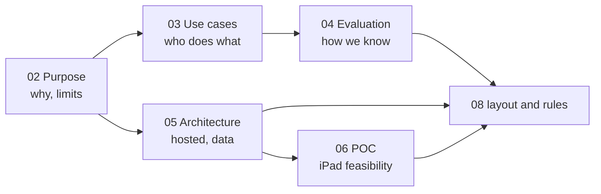

# SPRINT-006 outline: what each stage must decide

This page belongs to the [SPRINT-006 outline](03.19-sprint-006-outline.md). Draft of 22 November 2026; no decision is made here.

*Purpose and architecture decide first; the iPad feasibility check can start at once.*

| Stage | Decisions needed |
| --- | --- |
| 02 Purpose | Is preparation, with Alice taking an active role, a purpose outcome beside the meeting? What is the writing field for: a question, notes or his own words? Does a big field below everything keep the attention rule? Prepared answers must state nothing about him that his package does not |
| 03 Use Cases | A preparing use case (build, edit and check the top ten); a performing use case (a preset button shows its answer; what happens when a heard question differs); the iPad use case with no hardware keyboard, where touch buttons stand for the keys G, L, S, Esc and A |
| 04 Evaluation | How preset quality is judged (coverage of likely questions, time to first bullets from a button); touch targets; how pen input is checked, probably by Pablo by hand; hosted behavior on the iPad and its delay |
| 05 Architecture | The hosted mode in production: where the package and transcripts live in the cloud, retention, the access code, and the link to the "security later" decision (B-13); where the question list lives and who writes it; touch and pen as new input channels under "add, never remove" (B-11); the data statements |
| 06 POC | Whether the iPad's Safari can capture the microphone and run the audio and page code; the deploy README recommends the avatar off for "the 2015 iPad", an old device, so its limits matter; whether handwriting becomes text in the field |
| 08 Detailed Design | The layout of the writing field and the preset buttons, touch target sizes, and the rules, after 02 to 05 |
| 07, Pablo | The cut line (see the outline), the order, and the sprint start |

**Risks:** two large parts in one sprint, a new hosted exposure of his private package and transcripts, and an unknown iPad. Return to the [outline](03.19-sprint-006-outline.md) or to [Planning](README.md).
