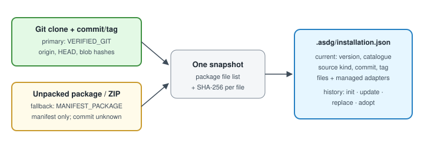

# ASDG installation state and sources

Every installation operation records what it installed and where it came from, so the next update has a trustworthy baseline.
Part of the [installation lifecycle plan](03.1-asdg-install-lifecycle-plan.md).



## Two source kinds, one engine

| Kind | Input | What is proven | Recorded |
| --- | --- | --- | --- |
| `VERIFIED_GIT` (primary) | clean local clone + full commit, or tag resolved to a commit | clean checkout, HEAD equals the selection, canonical origin, each file's Git hash | repository, commit, tag |
| `MANIFEST_PACKAGE` (fallback) | unpacked folder, with or without a top folder such as GitHub's `asdg-main/` | files match the package's own manifest; no revision exists | commit unknown |
| Adopt in place | the target's own committed `asdg/` | clean target; files equal HEAD; `--previous-ref` is a real commit | target HEAD, previous ref |

The canonical repository root is the `asdg/` folder, so "Download ZIP" is simply an unpacked package; no separate ZIP pipeline is needed.
Neither path uses the network. A user names the version; nothing selects "latest" automatically (see decision D3).
Source and target Git checks follow the [Git preconditions](03.5-asdg-install-git-preconditions.md); a dirty or mismatched source blocks before any comparison.
This reuses `source_snapshot()` and `package()` from `cli_install_source.py`, and retires the sync-only `snapshot()` reader that requires a Git origin.

## The installation record

A new `.asdg/installation.json` is written only by `init`, `update` and `replace`; `verify` and `status` only read it.

```json
{ "schema_version": 1,
  "current": { "version": "...", "catalog_sha256": "...",
               "source": { "kind": "...", "repository": "...", "commit": "...", "tag": "...",
                           "manifest_sha256": "...", "snapshot_sha256": "..." },
               "files": { "<asdg path>": "<sha256>" },
               "managed_files": { "<adapter path>": "<sha256>" } },
  "history": [ { "id": "...", "operation": "init | update | replace | adopt", "at": "...", "plan": "...",
                 "from": {}, "to": {}, "retained_local_edits": [], "resolutions": [],
                 "overwritten_local_edits": [ { "path": "...", "previous_sha256": "...", "recoverable_at": "..." } ] } ] }
```

## How existing state changes

- `project.json` stays the original init record; `binding()` checks the package against `installation.json.current`, not `distribution_version`.
- Projects without the record are read as an implicit baseline when versions match; only `update` or `replace` writes the first record.
- Update receipts move from `asdg/metadata/sync-state.json` to `.asdg/`, because a replace would overwrite anything inside `asdg/`; the old file stays readable.
- `managed_files` gives adapters their own baseline, so an adapter refresh can tell an unchanged file from a local edit.

## Compatibility check shared by update and replace

The incoming catalogue's roles and stages must match `project.json.stages`, and the new lifecycle rules must read the existing `lifecycle.json`.
Sprint, review-history, integrations and artifacts-root formats must still be supported; any mismatch blocks as "migration required", never migrates silently.
