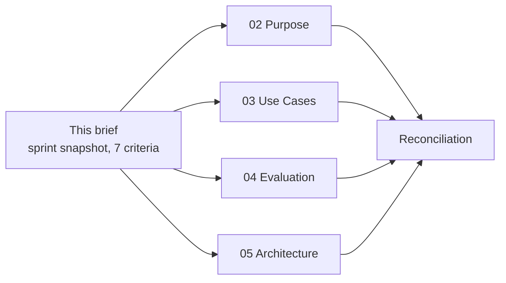

# SPRINT-005 review brief: the baseline for the first-pass reports

SPRINT-005, a faster Alice, is active. This is the one brief for step 2 of the sprint-align workflow: stages 02, 03, 04 and 05 each use this same text for their first-pass report. A draft by 07 Planning, 22 November 2026; no approval is recorded.

*Four independent reports from one baseline; the reconciliation follows.*

## The baseline

| Item | Value |
| --- | --- |
| Sprint | SPRINT-005 active on branch `sprint-05` from main `673c3bd7d465d5ecf809ba92734d49b625f78c7c`; `.asdg/sprint.json` SHA-256 `f17247ac1a648f7fbbf68f53f0e00211c3f153fd6228b10f18aa3db392d9721c` |
| Objective | Cut the time from the end of Pablo's speech to the Question and bullets on screen, and the model calls that show nothing, with cheap fixes only (no local models, no two-lane redesign, no new UI), and prove it on the same live questions |
| Scope | `index.html`, `index.md`, `app.js`, `app.md`, `poc/`, `openspec/changes/` |
| Direction | Pablo, 22 November 2026, relayed by 00 Governance: "try to be faster and more efficient", "without local LLM or anything special". Pablo's start command came after plan 03.18 |

## Commitments (the sprint's criterion IDs)

S005-FINAL: reader on final words only. S005-WASTE: fewer calls that show nothing (baseline 16 of 23). S005-SMALLER: each call carries less, tokens logged. S005-TIME: same questions before and after, against the 8.6 s mean. S005-QUALITY: Pablo marks answers usable. S005-STOP: Stop loses no speech; the guard only if WASTE shows it helps. S005-CARRY: one live session, statement check, review by 10.

## Constraints

The root `AGENTS.md` privacy rules apply: key, package, and meeting log never printed, committed or shared. No analysis component may use future audio, private transcripts, evaluator labels or reference answers.

## Known gap for reviewers

04's method reads existing log events; 08 proposes new `model_call` and `question_timing` events. 04 needs before-runs on the old code, so the logging must land before any behaviour change. Reviewers should say who owns that order.

## Sources (SHA-256 as of this brief)

| Source | SHA-256 |
| --- | --- |
| [Plan 03.18](03.18-sprint-005-plan.md) | `79d69c59ce52b56e503d06a2198fb126472c452124b92fa1f6136178c5dd30bd` |
| [04 measurement plan](../04-benchmarks-and-eval-strategy/03.14-sprint-005-measurement-plan.md) | `8c1a85b2baccc7338f597a427a7674342d33fa683aa8fc894a12266f0061a840` |
| [08 rules](../08-low-level-design/03.11-sprint-005-response-time-rules.md) | `52fbaeffdddfa1a4be6f5c76b503b635c581b86673267e95acd1e48388efa091` |
| [08 checks, open items](../08-low-level-design/03.11.1-s005-checks-and-open-items.md) | `3e6d122ddff38608a952ddd833f55ea0b60baced2d10d0ba2733ff3eaa39a274` |
| [09 analysis 08](../../../poc/docs/08-response-time.md) | `4e2b0c8feb025fe9cd717fe2e2c63b460202fdcf08b189a7d5a113529d82d2cc` |
| [08.1 times](../../../poc/docs/08.1-measured-times.md), [08.2 causes](../../../poc/docs/08.2-causes.md) | `6b0d4409842c20d71dc098e91a2cb33b179d431708cd38601875ed1c9dd1596c`, `c16bb87b363e2d986adda944f6e63684a668d4cc90c4aad25cc4b23d60eeb3c7` |
| [08.3 design](../../../poc/docs/08.3-proposed-design.md), [08.4 local models](../../../poc/docs/08.4-local-models.md) | `839c6b3065ce9fbcabd5dd3d41f2d435ed89ebd1517c00410deb0efe249e2da6`, `a1e730ca462374a0c6431b1aa78a270340b884ba6a44f088326d2c8095f2181e` |
| [08.5 plan](../../../poc/docs/08.5-plan-and-experiments.md) | `fde88ca80bc6baeff586cbec6264d2c4a7587fbc10ea792e987ccdec85ca4b8d` |
| [poc/README.md](../../../poc/README.md) | `d2adcc631cede3d8bfcf036b8bc4f36bf889f77df21b52b25d7eaa458c18c7d7` |

Return to [Planning](README.md).
