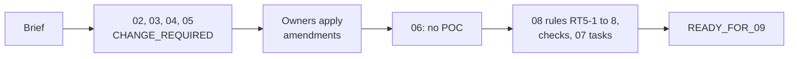

# SPRINT-005 alignment and readiness report, version 1

This is 07 Planning's report on the active SPRINT-005 (Alice.Good.Meetings), a draft of 22 November 2026. It grants no approval, starts no work and changes no state. **No document of this sprint carries a recorded approval or hash acceptance.**

*Four first passes, compatible amendments applied, no experiment, then rules and tasks.*

## Identity and direction

| Item | Value |
| --- | --- |
| Sprint | SPRINT-005, **active** on branch `sprint-05` from main `673c3bd7d465d5ecf809ba92734d49b625f78c7c`; `.asdg/sprint.json` SHA-256 `f17247ac1a648f7fbbf68f53f0e00211c3f153fd6228b10f18aa3db392d9721c` (seven criteria, S005-FINAL to S005-CARRY) |
| Baseline | [Brief](03.20-sprint-005-review-brief.md) `e9f5613ad213a23e6686f4f126e757155ee8cdc0492f9113a50c099e648b2029`; [plan 03.18](03.18-sprint-005-plan.md) `79d69c59…30bd`, unchanged |
| Direction (relayed) | Pablo, 22 November 2026: "try to be faster and more efficient", "without local LLM or anything special"; his start of the sprint followed the plan |

## Reviews (all `CHANGE_REQUIRED`, amendments applied by their owners)

| Stage | Session (as the lead gave it) | Report | SHA-256 | Amended |
| --- | --- | --- | --- | --- |
| 02 | `local_a306b659…` | [03.7](../02-purpose/03.7-sprint-005-purpose-alignment.md) | `5b793971…eb6ea9e` | A1 in [planned improvements](../02-purpose/03-planned-improvements.md) `1ddb624b…d42d0`; A2 waits for closeout |
| 03 | `local_1fcaca4d…` | [03.3](../03-system-model-and-use-cases/03.3-sprint-005-use-case-review.md) | `f65c461d…2cacf0` | A1, A2 in UC-04, UC-08, UC-09; A3 default log only |
| 04 | `local_2c3507bc…` | [03.15](../04-benchmarks-and-eval-strategy/03.15-sprint-005-evaluation-review.md) | `24a5e11e…340f587e` | [03.14](../04-benchmarks-and-eval-strategy/03.14-sprint-005-measurement-plan.md) `b2de3226…bf9fba15` |
| 05 | `local_e4dcc5de…` | [03.6](../05-high-level-design-and-architecture/03.6-sprint-005-architecture-review.md) | `60ced5ec…87de35` | A1 to A4 in 08's rules |
| 06 | `local_93c025b7…` | [03.3](../06-viable-proof-of-concept/03.3-sprint-005-poc-decision.md) | `979868f5…301204` | No POC |

Execution mode: separate specialist chats started by the lead, as the lead reported; I did not run them and did not verify their transcripts. Full session IDs were not given to me beyond the prefixes shown. I recomputed the hashes today (full values on [03.21.1](03.21.1-sprint-005-coverage.md)).

## Conflicts

One: the lead's first message said the 30-minute limit cannot drain; 03 followed 08, and RT5-6 drains at Stop **and** the limit, while only a disconnect or error cannot. 08, 03 and the lead agree now. The other findings (05's page change for Stop, 04's order and field gaps) are applied in 08's rules and 04's plan.

## Result: `READY_FOR_09`

`FOUNDATION_ALIGNED`: the six relationships hold and the seven commitments each have reason, scenario, check, design, decision, rule and task ([coverage](03.21.1-sprint-005-coverage.md), [tasks](03.21.2-sprint-005-task-list.md)). The one human choice, Q-S5-1, is **decided by Pablo on 22 November 2026, relayed by the lead: "Log only"**. A lost tail at Stop goes to the log (`speech_lost`) and nothing is shown on the page; this matches the default in 03 and 08, so no open item remains. **Plainly: no SPRINT-005 document has an approval or hash acceptance recorded**; readiness rests on Pablo's relayed direction and his own sprint start. 09 verifies role, sprint and path for each edit; `app.js` is in scope for the Stop change. Return to [Planning](README.md).
