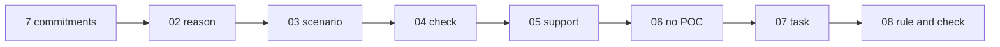

# SPRINT-005 coverage and freshness

This page belongs to the [alignment report](03.21-sprint-005-alignment-report.md). Draft of 22 November 2026; no approval is recorded.

*One row per commitment, left to right.*

| ID | 02 and 03 | 04 | 05 | 06 | 07 task | 08 |
| --- | --- | --- | --- | --- | --- | --- |
| S005-FINAL | 02: fewer replacements; 03: A1 wait in UC-04 | ST5-1, 2 | confirmed (C1) | no POC | S5-06 | RT5-1 |
| S005-WASTE | 02: less sent to OpenAI | at most 35% waste, none for changed words | RT5-4 version 1 | no POC | S5-03, S5-05, S5-10, S5-11, S5-12 | RT5-4, RT5-7 |
| S005-SMALLER | 02: same text, less waste | tokens, kept only on a gain | cache plausible, unverified | one measured, revertible step | S5-07, S5-08 | RT5-2, RT5-3 |
| S005-TIME | 02: A1 pass rule replaces "no limit" | median 1.5 s lower, worst no higher | no new component | no POC | S5-03, S5-05, S5-10, S5-11 | RT5-5, SH5-1 |
| S005-QUALITY | 02: three acceptance questions | at least 24 of 30, within one of before | none | no POC | S5-05, S5-10 | SH5-1 |
| S005-STOP | 03: A2 Stopping state, A3 default log | live Stop, `speech_lost` 0 | page change confirmed (A1) | `speech_lost` not zero returns to 05 | S5-09, S5-10 | RT5-6, ST5-8, 9, PC5-1, 2 |
| S005-CARRY | 02: avatar question | statement check on final README | no data change | no POC | S5-13 | outside 08 |

## Freshness (SHA-256 as assessed, 22 November 2026)

[03.14](../04-benchmarks-and-eval-strategy/03.14-sprint-005-measurement-plan.md) `b2de3226b3181f20a63e64876b0e874d2c5a507ea049ee28aa68e9e9c97fba15`; [rules](../08-low-level-design/03.11-sprint-005-response-time-rules.md) `e178b30857761c99153e9130f8c192fc134ed31c28db8ff09fbf2573f6647d58`; [checks](../08-low-level-design/03.11.1-s005-checks-and-open-items.md) `b3dcd7b046fa97d43886e12ff751c5732f06cc663dd463f6e2e62cb16e870456`; 02 `5b7939719946f810cea990e52b5cd27e069f475237d970cd0878e36caeb6ea9e`; 03 `f65c461d31b90b1a455c7d6cead885fa0cc553465069b101c512ddd68e8cacf0`; 04 `24a5e11ee70a66b0ec461a1f08c3ac1afee27d7cde632885f1bc3c80340f587e`; 05 `60ced5ec7c39676ba22515b678a97c7ab7ebd1bdf6ddd1f3e5299ae89587de35`; 06 `979868f5384ff0447d3dc6c0134a5e34bb474f8813d74cc1fcffd7906d301204`. A change to a criterion, rule or pass rule invalidates what depends on it; recheck before 09 starts. Not recomputed here: 09's analysis pages (the brief holds their hashes).

No OpenSpec change for SPRINT-005 exists yet (`openspec/changes/` holds none for it); 08's rules and checks are the specification. 08 or 09 may add one if the lead wants parity with SPRINT-004. Return to [the report](03.21-sprint-005-alignment-report.md).
