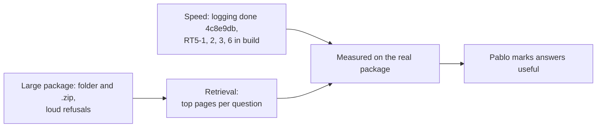

# SPRINT-005 revised: speed and a large package (draft for Pablo's decision)

This is a draft of 07 Planning, 22 November 2026, for Pablo to decide tomorrow. It changes no sprint record and starts or stops nothing; the active record cannot be amended in place. Pablo's direction tonight, relayed by the lead: "we really need to fix all the package upload... the limits", "I want to see large packages being uploaded and used", "this version is still not good for real face to face interview". His real package is 28 files and about 591,000 characters; the limit (20 files, 20,000 characters) refused it and the answers came from the old package. No approval is recorded.

*The speed work stays; the package becomes part of the same measurement.*

## Revised definition (draft)

**Objective:** *Make Alice fast and useful on Pablo's real, large package: answers come sooner and for less, hundreds of files and hundreds of thousands of characters load, none is refused unseen, and each question is answered from the right part of the package, judged by Pablo on his own package.*
**Criteria:** keep S005-FINAL, WASTE, SMALLER, TIME, STOP and CARRY as they are. Add:
1. **PKG-LOAD** (B-22, B-04): a folder or one .zip loads; hundreds of files and about 600,000 characters or more; `.md` and `.txt` only; zip safety limits set by 05.
2. **PKG-VISIBLE:** a refused or partial upload cannot be missed: the page says how much loaded and how much was skipped, and why, in the bar's own size, not small print.
3. **PKG-USE:** a large package is used per question; only the best 3 to 5 pages go to the reader, chosen by 05's approach (draft idea: questions anticipated per page at load, matched to the heard question by meaning and keywords; package-first caching). 05 decides, 04 sets the checks.
4. **PKG-USEFUL:** Pablo marks answers on his real package; 04 sets the pass rule; a follow-up keeps the previous exchange. QUALITY is judged on this package, not the 19 November one.

## What moves from SPRINT-006 and what stays

| Moves into this sprint | Stays in SPRINT-006 |
| --- | --- |
| B-22 folder and zip, B-04 limits, package visibility, retrieval per question, follow-up memory | B-20 iPad and pen: writing field, touch buttons, hosted mode |
| | B-21 preparation skill and presets: they build on a large package, so they follow it |

The iPad .zip route in B-22 is then already built. SPRINT-006's use of presets depends on this sprint's large package.

## Two ways to record it

| Option | Effect |
| --- | --- |
| **A. Close SPRINT-005 unfinished, start a new sprint** with this definition | The receipt keeps what was done (logging, speed steps) and the new record carries the added criteria and new before-runs |
| **B. Close and restart SPRINT-005 itself** | One name, but one ID would hold two definitions, and the before-runs and criteria IDs would need explaining |

**Recommendation: A.** The record cannot be amended, the speed evidence is already tied to SPRINT-005's criteria, and the before-runs on the real package are a new baseline. The CLI has `start` and `stop` only; I did not check whether it permits a restart under the same ID. The new sprint takes the next number and the iPad sprint shifts one number; the sprint-start still needs a clean worktree and Pablo's command. Return to [Planning](README.md).
