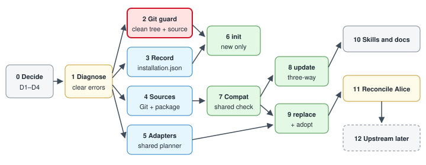

# ASDG installation increments and tests

Thirteen bounded increments; each is tested and reviewed before the next starts.
Part of the [installation lifecycle plan](03.1-asdg-install-lifecycle-plan.md); file paths are under `asdg/scripts/lib/` unless shown.

## Increments

| # | Increment | Main files | Done when |
| --- | --- | --- | --- |
| 0 | Settle D1–D4; select ASDG Admin with an authorized scope; create a working branch | — | Scope and branch recorded |
| 1 | Diagnostics: a distinct `UNRECORDED_METHODOLOGY_CHANGE` with the exact next action; status still reports sprint and lifecycle; the gate gives the right reason | `cli_project.py`, `cli_status.py`, `cli_sprint.py` | Alice's status shows SPRINT-002 and the fix |
| 2 | Git guard per [Git preconditions](03.5-asdg-install-git-preconditions.md): target and source cleanliness, settled HEAD, source revision, ignored collisions, fingerprint, exact codes and corrective actions; read-only Git commands only | new `cli_git_guard.py` | Every failure code and the clean case tested; no Git mutation observed |
| 3 | Installation record: schema, validation, legacy fallback, binding reads it | new `cli_installation.py` | Valid, legacy, corrupt and mismatched records tested |
| 4 | One source reader using the guard: tag → commit, package root with or without top folder, no network | new `cli_source.py`, `cli_install_source.py` | Clone, tag, folder and GitHub ZIP yield the same files; stale manifest, dirty or mismatched source refused |
| 5 | Shared adapter planner, moved out of `init`: add missing, replace unchanged, conflict on local edits, delete only unedited tracked files; keeps bootstrap merge and backups | new `cli_integrations.py`, `cli_project.py`, `cli_clients.py` | Add, replace, conflict and delete tested for Claude and Codex |
| 6 | `init` for new installs only: refuse when `.asdg/project.json` exists or `.asdg/` is non-empty; Git guard at preview and apply; write the first record | `cli_install.py`, `cli_project.py`, `cli.py` | Second init and dirty-tree init fail with no writes; fresh init leaves only planned paths changed |
| 7 | Shared compatibility check (see [state and sources](03.2-asdg-install-state-and-sources.md)) | new `cli_compat.py` | Each incompatibility blocks with a clear reason |
| 8 | `update`: rename `upgrade` (alias kept); Git guard at preview and apply; three-way with the record as baseline via `classify()`; local-only edits kept; conflicts block with three hashes and diffs; optional `--resolutions <json>` recorded per path; adapters and history in the same plan | new `cli_update.py`, `cli_sync.py`, `cli.py` | Clean, retained-edit, conflict, resolution, deletion and Git-failure cases pass for both source kinds |
| 9 | `replace`: Git guard at preview and apply; whole swap including deletions; every lost local edit listed by its Git commit; needs `--confirm-replace`; `--adopt-in-place --previous-ref <ref>` for a folder already swapped and committed | new `cli_replace.py`, `cli.py` | Replace, adopt, incompatible-package and Git-failure cases pass |
| 10 | Skills and docs: rewrite `asdg-init` and `asdg-update`, add `asdg-replace` with adapters, all stating the clean-tree rule; update installation, synchronization and verification guides and Help; companion `.md` for every changed `.py` | `asdg/skills/`, `asdg/templates/`, `asdg/docs/` | Documentation review criteria pass |
| 11 | [Reconcile Alice](03.4-asdg-install-alice-reconciliation.md) | — | `verify` clean; gate checks SPRINT-002 scope |
| 12 | Propose upstream with `promote`, as a separate authorized task | — | Later |

With a clean tree required, uncommitted local edits cannot exist at replace time, so no uncommitted backup path is needed; every lost edit is recoverable from a commit.

## Acceptance criteria for every command

- Preview and apply each reject a dirty, unsettled or unreadable target, and a dirty or mismatched Git source, with the exact code and corrective action.
- A planned write onto an existing ignored file blocks; a planned file Git would ignore is reported.
- Changing HEAD, branch, any file or the source between preview and apply invalidates the token.
- After success, `git status` lists exactly the planned paths and HEAD is unchanged; after rollback, the tree is clean.
- No test observes a commit, stage, stash, reset, clean, checkout or branch switch made by ASDG.

## Tests

Extend `test_install.py` and `test_distribution.py`, turn `test_sync.py` into `test_update.py`, and add `test_git_guard.py`, `test_replace.py`, `test_installation.py` and `test_compat.py`.
Git cases, in disposable repositories: staged, modified, deleted and untracked files; submodule change; unfinished merge and rebase; no commit; dirty source; source at a different commit; tag resolving elsewhere; ignored collision; would-be-ignored output; change between preview and apply; rollback cleanliness; reflog and stash unchanged.
Fixtures are disposable Git repositories in temporary folders, never Alice and never the canonical repository.
After every increment run `python3 -B -m unittest discover -s asdg/tests -v`; `test_install.py` and `test_sync.py` hold 41 tests today.
Report configured, observed and tested results separately; passing tests are not human acceptance.
