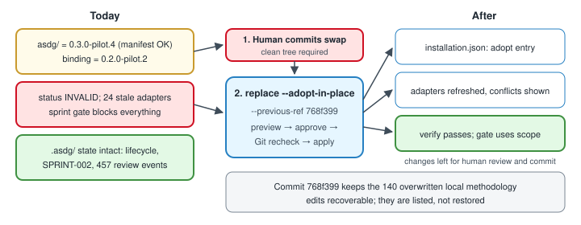

# Reconciling Alice after the manual ASDG swap

Alice's methodology folder was replaced by hand. This explains what that changed and how to record it without reinitializing or losing evidence.
Part of the [installation lifecycle plan](03.1-asdg-install-lifecycle-plan.md).

## What we observed on 13 November 2026

- `.asdg/` is untouched: binding at 0.2.0-pilot.2 with catalogue `e718…`, Purpose accepted, stages 02–05 recorded, 457 review events, SPRINT-002 active, two closeouts, Claude and Codex recorded.
- `asdg/` now holds 0.3.0-pilot.4 and matches its own manifest. The catalogue hash is unchanged, so only the version check fails.
- With the binding accepted, 24 adapter errors remain: Help, Update and Report-project-status skills are missing, and all 13 `.codex/agents/*.toml` files differ.
- The committed `asdg/` at `768f399` had 311 local edits or extra files beyond its own manifest: 171 now match the new package, 140 differ, and 2 are gone.
- Those 140 edits are overwritten in the working tree but recoverable from `768f399`; they may have been superseded upstream, which is not yet verified.
- No sync receipt exists, but the old manifest is byte-identical to `asdg/metadata/deliveries/0.2.0-pilot.2.json`, a usable baseline.
- `sprint check-implementation --path app.js` currently returns `IMPLEMENTATION BLOCKED` because of the binding error.

## Recommended path: adopt the swap as a replace

1. **Clean tree first.** Alice is dirty today: the swapped `asdg/`, these plan documents and their review receipts are uncommitted. The human commits them per decision D1; ASDG never does.
2. `768f399` remains the pre-swap evidence; the new commit holds the swapped folder, so adopt-in-place has a committed source.
3. Dry run `replace --adopt-in-place --previous-ref 768f399`; the Git guard confirms a clean, settled tree and that `asdg/` equals HEAD.
4. Expect the source as `MANIFEST_PACKAGE` with commit unknown, unless the canonical commit is named and verified.
5. Expect a passing compatibility check, the 140 overwritten edits and 2 removals listed, about 24 adapter changes using `768f399:asdg/templates` as their baseline, and one `adopt` history entry.
6. After human review, apply with the plan token; the guard rechecks HEAD and cleanliness first.
7. Run `verify` and `status`, check the gate on a SPRINT-002 path, then review and commit the changed paths yourself.
8. Optionally review the 140 overwritten edits; any still needed become a separate methodology change.

## Alternative: restore and update

Restore `asdg/` from `768f399` yourself, commit, and run a real `update` from the package under the same clean-tree rule.
Expect about 140 conflicts needing individual decisions; worth it only if those local edits matter more than the swap.

## What not to do

Do not run `init`: it would fail at the binding today, and forcing it would be the wrong lifecycle path.
Do not edit `.asdg/project.json` by hand to silence the error; that would erase the evidence of what changed.
Do not stash, reset or clean to pass the Git check; commit the intended work deliberately instead.
