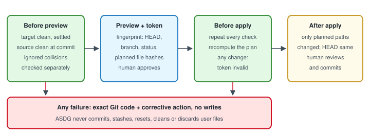

# Git preconditions for ASDG installation

`init`, `update`, `replace` and `replace --adopt-in-place` start only from a clean consumer Git working tree, so every change they make is reviewable and nothing of the user's is mixed in or lost.
Part of the [installation lifecycle plan](03.1-asdg-install-lifecycle-plan.md).

## Invariant

1. **Clean target.** `git status --porcelain=v1 --untracked-files=all --ignore-submodules=none` must succeed with empty output: no staged, modified, deleted or untracked files, including submodule changes. An unreadable status is unknown, never clean.
2. **Settled repository.** HEAD must be an existing commit; an unfinished merge, rebase, cherry-pick, revert or bisect blocks even when the listing is empty.
3. **Clean source.** A Git source must be clean by the same rule, and its HEAD must equal the selected commit (a tag resolves to that commit). A package folder has no revision and is checked by manifest only, recorded as such.
4. **Adopt in place.** The source is the target's own committed `asdg/`, so the clean target plus the `--previous-ref` commit fully identify both sides.
5. **Fingerprinted plan.** The plan token covers the Git directory, target HEAD, branch or detached state, the empty status result, source HEAD, ignored-collision results and every planned path's current hash.
6. **Recheck before apply.** Apply repeats checks 1–3 and 6 and recomputes the plan; any difference invalidates the token and requires a fresh preview and approval.
7. **Ignored files checked separately.** Git's clean definition excludes ignored files, so each planned path is checked with `git check-ignore` and against existing ignored files. Overwriting an existing ignored file blocks; a planned file that Git would ignore is reported, because it could never be committed.
8. **No Git mutation.** ASDG never commits, stages, stashes, resets, cleans, checks out, switches branch or discards files, and never edits ignore rules to pass a check.
9. **Left for review.** After a successful apply, `git status` lists exactly the planned paths and HEAD is unchanged; the human reviews and commits. A rolled-back apply leaves the tree clean again.

## Failures and corrective actions

| Code | Meaning | Corrective action shown |
| --- | --- | --- |
| `GIT_NOT_REPOSITORY` / `GIT_NO_COMMIT` | Target is not a Git root, or HEAD has no commit | Run from the repository root; make an initial commit yourself |
| `GIT_OPERATION_IN_PROGRESS` | Merge, rebase, cherry-pick, revert or bisect unfinished | Finish or abort it yourself, then preview again |
| `GIT_WORKTREE_DIRTY` | Staged, modified, deleted or untracked paths; each listed with its status | Commit or stash those changes yourself, then preview again |
| `GIT_STATUS_UNREADABLE` | `git status` failed or timed out | Repair the repository; the check fails closed |
| `GIT_SOURCE_DIRTY` / `GIT_SOURCE_REVISION_MISMATCH` | Source checkout dirty, or HEAD differs from the selected commit or tag | Clean the source or check out the selected revision yourself |
| `GIT_IGNORED_COLLISION` | A planned write targets an existing ignored file | Move or remove that file yourself, or adjust ignore rules deliberately |
| `GIT_TARGET_CHANGED` | HEAD, branch or status differs from the preview | Review a fresh preview; the old approval no longer applies |

## Today

Init's token already records Git directory, HEAD and branch, but no command checks working-tree cleanliness. `upgrade` only refuses to delete untracked files.
The sprint-start [Git preflight](../../../asdg/skills/asdg-sprint-start/git-preflight.md) already defines the same status command and unfinished-operation rule; the new guard reuses it.
