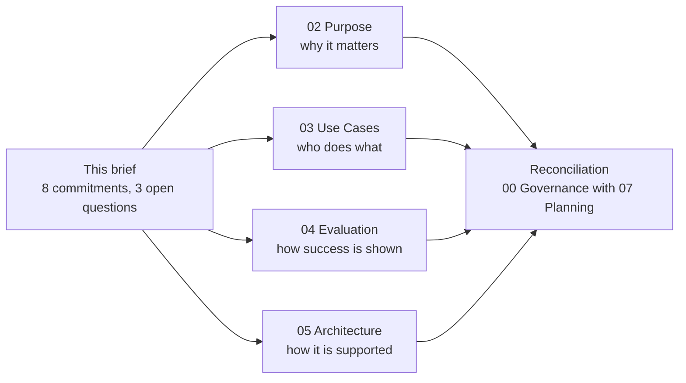

# SPRINT-003 review brief: a new page design and a proposed answer

SPRINT-003 gives Alice (Alice.Good.Meetings) a new page layout and lets her propose an answer to the Focus question.
Before any code is written, Purpose, Use Cases, Evaluation and Architecture each check this same baseline against their own documents. All four receive this text unchanged.

*Each stage writes its first report from this baseline before seeing the other stages' new conclusions.*

## The baseline

| Item | Value |
| --- | --- |
| Sprint | SPRINT-003, active; read with `python3 asdg/scripts/cli.py sprint status --json` on 16 November 2026 |
| Snapshot | `.asdg/sprint.json`, SHA-256 `c81510f030ff0e85aa758a7145477807739839bd9e2943dcf36a062850e1ddc4` |
| Git | Branch `sprint-03`, revision `7d60c0ffbec9dd211eceb3b0bb0957750f0519e0` |
| Objective | "Give Alice a new page design and let her propose an answer to the Focus question." |
| Scope | `index.html`, `index.md`, `app.js`, `app.md`, `images/`, `poc/`, `openspec/changes/` |

The snapshot is uncommitted: the sprint record in revision `7d60c0f` is still inactive, so the hash identifies SPRINT-003 and the revision identifies every other file.
No application file and no document of stages 02 to 05 differs from that revision.

## Commitments

Criteria 1 to 7 are quoted from the sprint record. S003-LAYOUT is Pablo's layout decision, which frames criteria 1 and 2.

| ID | Commitment | Source |
| --- | --- | --- |
| S003-LAYOUT | Layout "B, cue first": the full-screen cue color and large cue word stay as today; the Focus question and the proposed answer are two cards; the Live question is a bar with its Confirm button. | Decision, 16 November |
| S003-PREVIEW | "Pablo approves the new page layout from a preview before it replaces the current page." | Criterion 1 |
| S003-GLANCE | "The Focus question, the Live question and the GOOD / LAND IT / STOP cue stay readable at a glance in the new layout." | Criterion 2 |
| S003-ANSWER | "When a Focus question is set, Alice shows a proposed answer for it; it is replaced when the Focus question changes and never overwrites the question." | Criterion 3 |
| S003-NOKEY | "Without an OpenAI key the page still works and says that proposed answers are unavailable." | Criterion 4 |
| S003-TESTS | "node --test poc/poc.test.mjs passes, with new tests for the proposed answer." | Criterion 5 |
| S003-RUN | "bash poc/alice-run.sh starts the server or reuses one already running." | Criterion 6 |
| S003-LIVE | "Pablo runs one live session and the result is recorded as pass or fail." | Criterion 7 |

Three questions about the proposed answer are still open: S003-Q1 (form), S003-Q2 (trigger) and S003-Q3 (inputs).
[Direction, open questions and constraints](03.6.1-sprint-003-brief-direction.md) gives Pablo's words, those questions and the limits every stage must respect.
[Sources](03.6.2-sprint-003-brief-sources.md) lists the exact documents and hashes each stage assesses.

## What each stage returns

Save one report in your own stage folder and return its link. The first pass is read-only: propose amendments, do not apply them yet.
The report states this baseline, the commitment IDs it covers and the source sections and hashes it relied on.
It names missing, contradictory or ambiguous content, and each required amendment or an evidenced no-change conclusion, with the implications for later stages.
For each open question, say what your documents imply and whether it blocks your verdict. The choice itself is Pablo's.
S003-TESTS and S003-RUN are technical: trace them to an existing workflow, quality need or operating rule, not to a new user-facing feature.
End with one verdict: `ALIGNED`, `CHANGE_REQUIRED`, `NEEDS_DECISION` or `MISSING_EVIDENCE`.

## Status

Prepared by 07 Planning on 16 November 2026 for the alignment run that 00 Governance coordinates at Pablo's request, following the [review method](../../../asdg/skills/asdg-sprint-align/reviews.md).
It is a review input: it assesses no stage, approves nothing, changes no sprint state and starts no coding. Return to [Planning](README.md).
