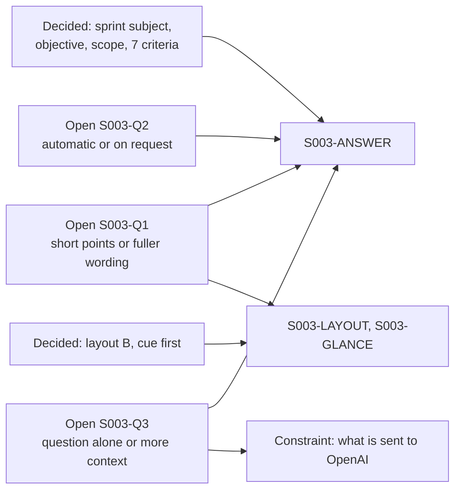

# SPRINT-003 brief: direction, open questions and constraints

This page belongs to the [SPRINT-003 review brief](03.6-sprint-003-review-brief.md). It separates what Pablo has decided from what is still open, and lists the limits every reviewing stage must respect.

*Decided direction is carried forward. The three open questions all bear on the proposed answer; its length also bears on glanceability, and its inputs on what leaves the Mac.*

## What Pablo has said

All on 16 November 2026, as relayed to Planning by 00 Governance; Planning did not see the original messages.

- **Subject:** "This new sprint will be about a new page design and the ability for alic to propose an aswer to the selected question".
- **Approval:** he approved the recorded objective, scope and seven acceptance criteria, on the condition that starting the sprint does not start coding.
- **Layout:** "B, cue first". The full-screen cue color and large cue word stay as today; the Focus question and the proposed answer are two cards; the Live question is a bar with its Confirm button.
- **Run command:** "please create a future alice-run scrpt/command to do this more eficiently". This is the origin of S003-RUN.
- **Alignment:** he asked for this alignment before any coding, with decisions already made carried forward and only material unresolved questions brought back to him.

## Open questions

Pablo has not decided these. 00 Governance proposed answers only as assumptions, so treat each one as open.

- **S003-Q1 Form:** is the proposed answer a few short points or fuller wording?
- **S003-Q2 Trigger:** does it appear automatically when a Focus question is set, or on request?
- **S003-Q3 Inputs:** is it built from the question alone, or may it use his résumé or other context, which would be sent to OpenAI?

No stage settles them and agreement between stages does not settle them. They return to Pablo as bounded choices.

## Project constraints

From the root [AGENTS.md](../../../AGENTS.md), SHA-256 `e5d86d5dadfe4dac7fe212d39510fc0fc1f93720c825ce8fcc9f2c1b29de01fa`:

- Preserve the user's attention: brief, glanceable visual cues; spoken coaching previously interrupted his thinking.
- The OpenAI key lives only in `poc/.env.local`, which Git ignores; it is never printed or committed.
- While the POC listens, microphone audio and selected transcript text go to OpenAI.
- `poc/browser-smoke.mjs` makes billable OpenAI requests and uses synthetic speech, never a private benchmark recording.
- No analysis component may access future audio, private transcripts, evaluator labels or reference answers.
- The benchmark transcript and timestamps in `eval-data/` are evaluation references, not live-agent inputs, and stay unchanged.

## Sprint constraints

- Work stays inside the recorded scope; `eval-data/`, `asdg/` and `.asdg/` are outside it.
- An active sprint is not permission to code. Implementation waits for the readiness result and the per-target check in the [sprint gate](../../../asdg/00-governance/docs/sprint-gate.md).
- The review changes no sprint record, scope, criterion or approval. A needed change to any of them is Pablo's decision.

Return to the [brief](03.6-sprint-003-review-brief.md) or to [Planning](README.md).
