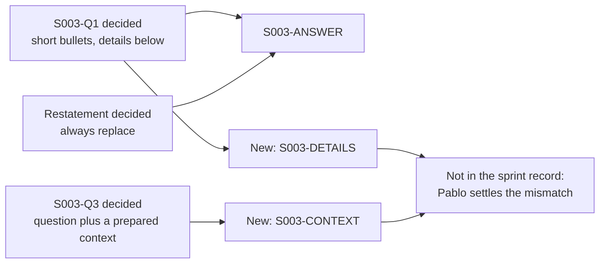

# SPRINT-003 brief addendum: Pablo's answers of 16 November

This page adds to the [SPRINT-003 review brief](03.6-sprint-003-review-brief.md) without changing it. Pablo answered the open questions after the four first-pass reviews were written.
Where it differs from the open questions in the brief's [direction page](03.6.1-sprint-003-brief-direction.md), this page is newer and prevails.

*Three decisions sharpen S003-ANSWER and create two commitments that the recorded sprint criteria do not mention.*

## What Pablo decided

His words, typos included, as given to 00 Governance on 16 November 2026 (local time) and relayed to Planning, which did not see the original messages.

| Topic | His words | Meaning for the sprint |
| --- | --- | --- |
| S003-Q3 Inputs | "we will send a context that we will build accrodingly. if this is an interview we will use an interview preparation packages that will inclkude my resume + other documents. not all meetigns are interview....but let focus on interview first" | The answer is built from the Focus question plus a prepared context. For this sprint that is an interview preparation package with his résumé and other documents, and its text is sent to OpenAI. The Purpose deferral of résumé-based suggestions is lifted. |
| S003-Q1 Form | "the current prposd small answer screen beside the question will be a few buttle points easy and shiort. but we need another window below to add details. the interviewer may or may not care about the details... but it shouuld have then just in case. in the future is posiboe that hte bullet point come faster than the detalas, mayb we do two calls to llm. for now is one call" | The card beside the Focus question holds a few short bullet points. A second area below holds supporting details. One model call produces both; two calls, bullets first, is a possible later change. |
| Restatement | "Yes, always replace" | Any change to the Focus question, including a confirmed rewording, gives a new proposed answer. |

## Carried forward and assumed

- **S003-Q2 Trigger** was not asked. It is carried forward from criterion 3 as Pablo approved it: the answer appears automatically when a Focus question is set.
- **Criterion 4, no key:** not decided. His answer was "let fis the key!", which 00 Governance reads as wanting the key put in place and is confirming with him. Until he says otherwise, a minimal reading is an assumption: the page loads, the timer and cue work, and a clear message says question recognition and proposed answers are unavailable.

## Two new commitments

| ID | Commitment | Source |
| --- | --- | --- |
| S003-DETAILS | An area below the cards shows supporting details for the proposed answer, produced by the same model call as the bullet points. It amends layout "B, cue first". | Decision on S003-Q1 |
| S003-CONTEXT | The proposed answer uses a prepared context sent to OpenAI with the Focus question; in this sprint, an interview preparation package with his résumé and other documents. | Decision on S003-Q3 |

Neither appears in the recorded objective, scope or seven criteria, and S003-LAYOUT as recorded has no details area. This is a sprint-record mismatch for Pablo to settle through the sprint process. Nobody edits `.asdg/sprint.json` in this run.

## Obligations these decisions create

00 Governance named these for the owning roles. Planning records them and assigns none.

- Where the package is kept: outside Git, and inside the sprint scope if code reads it.
- What leaves the Mac, stated in the design and in the data statements of the root `AGENTS.md` and `poc/README.md`.
- An answer states nothing about Pablo that the package does not contain.
- The package never includes benchmark recordings, evaluator labels or reference answers.

No stage has yet assessed the two new commitments. Prepared by 07 Planning on 17 November 2026 UTC. See the [alignment report](03.7-sprint-003-alignment-report.md) or return to [Planning](README.md).
