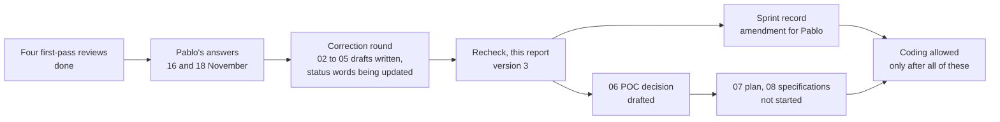

# SPRINT-003 alignment report: version 3

SPRINT-003 gives Alice (Alice.Good.Meetings) a new page layout and a proposed answer to the Focus question. This version rechecks the foundations after the correction round, in which stages 02 to 05 wrote their amendments and 06 wrote its decision, and after Pablo's "Accept all" of 18 November 2026 on the recommended defaults.
**Result: the foundations are close to aligned, but not yet `FOUNDATION_ALIGNED`, and the sprint is `NOT_READY` for coding.** Four things stand between the sprint and its first edit: the sprint record does not hold the two new commitments, the owners have not yet marked the accepted defaults as decided, 07 and 08 have not written their parts, and one data statement has no owner.

*Where the alignment run stands. Version 2 had stopped before the correction round.*

## Identity and versions

| Item | Value |
| --- | --- |
| Project and sprint | Alice.Good.Meetings (Alice), SPRINT-003, active |
| Sprint snapshot | `.asdg/sprint.json`, SHA-256 `c81510f030ff0e85aa758a7145477807739839bd9e2943dcf36a062850e1ddc4`, unchanged |
| Git | Branch `sprint-03`, HEAD `bde3f7a4202381fe6fed19a7d4bb29e6b32a7d03`; stage pages are uncommitted edits, 29 changes in all |
| Observed | Version 3 on 18 November 2026; versions 1 and 2 on 17 November 2026 at 00:30 and 00:37 UTC |
| Decisions | The [brief addendum](03.6.3-sprint-003-brief-addendum.md) of 16 November and 00 Governance's relay of 18 November: "Accept all" on twelve defaults. Planning did not see Pablo's messages |

Version 2 is kept in Git commit `112cad2`. Its hashes: report `9dca2e4bf1612449a2d129ee08b2dc78231e94ec47767109d842aff9fc2f3567`, coverage `078bc85d6a57026a259f64c1bada64515a96fc7a62ec427e7ae1cd4fc3dc7dcf`, conflicts `3e25ff437e6641080cd31e482192f717bd833ce22b6b3cabad7299a1fcd053d6`, amendments `c06f8b7ed2f5d754690906394607445f6c6a13708226209314e63ea30db57515`.

## Reviews and the pages they led to

The four first-pass reviews are each `CHANGE_REQUIRED` and still read as first-pass history: [02](../02-purpose/03.1-sprint-003-purpose-review.md), [03](../03-system-model-and-use-cases/03-sprint-003-use-case-review.md), [04](../04-benchmarks-and-eval-strategy/03.5-sprint-003-evaluation-review.md) and [05](../05-high-level-design-and-architecture/03.1-sprint-003-architecture-review.md).
**Hash discrepancy:** none of the four files has the hash version 2 recorded. The files are unchanged in Git since the baseline commit `112cad2`, and their text matches the first-pass reviews, but version 2's bytes are not in Git, so the cause is not established. Version 2's hashes are kept in the [coverage page](03.7.1-sprint-003-coverage.md) beside the current ones. This version depends on the current hashes only.
All pages named here are drafts. No document acceptance is recorded for any of them, and a page that cites "Accept all" does so as 00 Governance's relay.

## Findings

- [Coverage](03.7.1-sprint-003-coverage.md): the ten commitments, now with the current document and hash for each stage.
- [Conflicts and gaps](03.7.2-sprint-003-conflicts.md): the six relationships rechecked and the eighteen items with their present state.
- [Proposed amendments](03.7.3-sprint-003-amendments.md): which amendments were applied and what is still open.
- [Sprint-record amendment](03.7.4-sprint-003-record-amendment.md): the exact text and route for Pablo.

## Result and what remains

Foundation: not yet `FOUNDATION_ALIGNED`. The six relationships hold in the drafts; the remaining gaps are status words in 02 and 05, the layout preview and one observed run (C3, C9). Readiness: **`NOT_READY`**.
Before coding, in order: Pablo settles the sprint record; 02 and 05 mark accepted defaults as decided; 04 and 06 confirm their drafts; 07 writes the plan; 08 writes the specification; N5 gets an owner. A changed sprint record, review or source page makes this version stale.
It approves nothing, changes no state and starts no work. Prepared by 07 Planning under the [report contract](../../../asdg/skills/asdg-sprint-align/report.md). Return to [Planning](README.md).
