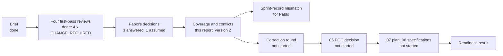

# SPRINT-003 alignment report: version 2

SPRINT-003 gives Alice (Alice.Good.Meetings) a new page layout and a proposed answer to the Focus question. Four stages reviewed the same [brief](03.6-sprint-003-review-brief.md) separately, and Pablo has since answered three open questions, recorded in the [brief addendum](03.6.3-sprint-003-brief-addendum.md).
**Result so far: the foundations are not aligned and the sprint is `NOT_READY` for coding.** All four stages require changes to their own documents, the correction round has not started, and his answers add two commitments that the sprint record does not contain.

*Where the alignment run stands. Everything to the right of this report is still to do.*

## Identity

| Item | Value |
| --- | --- |
| Project and sprint | Alice.Good.Meetings (Alice), SPRINT-003, active |
| Sprint snapshot | `.asdg/sprint.json`, SHA-256 `c81510f030ff0e85aa758a7145477807739839bd9e2943dcf36a062850e1ddc4`, unchanged since the brief |
| Git | Branch `sprint-03`, revision `7d60c0ffbec9dd211eceb3b0bb0957750f0519e0` |
| Observed | Version 1 on 17 November 2026 at 00:30 UTC; version 2 at 00:37 UTC |
| Direction | Pablo's instructions of 16 November in the [brief's direction page](03.6.1-sprint-003-brief-direction.md), and his later answers in the [addendum](03.6.3-sprint-003-brief-addendum.md) |

## Reviews

00 Governance dispatched the four reviews in parallel to separate role chats on 17 November 2026 UTC. Each report says it was written before reading the others, and all were written before Pablo's answers. Planning recomputed every hash below.

| Stage | Report | Verdict | Session | SHA-256 |
| --- | --- | --- | --- | --- |
| 02 Purpose | [Purpose review](../02-purpose/03.1-sprint-003-purpose-review.md) | `CHANGE_REQUIRED` | `local_4f904c19-90be-4650-9ab0-490b59f1a4da` | `afc8c4c67d8077649afcbafe33c25200cd8f420a29b3ce15ded45df89e01882c` |
| 03 Use Cases | [Use-case review](../03-system-model-and-use-cases/03-sprint-003-use-case-review.md) | `CHANGE_REQUIRED` | `local_d4a6a733-5151-42aa-b9cd-2d4d8cceb5e4` | `a73f531857400da5de62146f0c7bedea4335a9637efdfe69880922940ee2a057` |
| 04 Evaluation | [Evaluation review](../04-benchmarks-and-eval-strategy/03.5-sprint-003-evaluation-review.md) | `CHANGE_REQUIRED` | `local_0cfb4e27-d183-4546-a9bd-7b01496eca38` | `b5010a0011d061586c7e185aea31bc99a9621330f3abbea48d54456e2822acf8` |
| 05 Architecture | [Architecture review](../05-high-level-design-and-architecture/03.1-sprint-003-architecture-review.md) | `CHANGE_REQUIRED` | `local_ef3e1367-85a1-450e-93a0-a47155faca88` | `93894a2ffb3649255f687b0f99ece873606a7bae68113652c992ceb64d4565f2` |

All four read code and documents only; nothing was run. None has assessed the two new commitments, S003-DETAILS and S003-CONTEXT.

## Sources and their status

The reviewed documents and hashes are in the [brief's sources page](03.6.2-sprint-003-brief-sources.md). The project records show no acceptance of any of them, so the intended baseline is a set of drafts plus Pablo's direction.
Two cosmetic changes followed the brief: the Stage 03 README gained a link to its review (now `fac9547ef1299358c6e1d22e5cd67b85c8860e6fa01f2b24e78ce00de55db4ec`) and the Stage 04 README gained one too (now `627856d9c096646fe8f611ae25e2bbae3ca9ae57a7896205f68b6de94be4943b`).
The four review reports are new, unreviewed drafts by their stages.

## Findings

- [Coverage](03.7.1-sprint-003-coverage.md): what each stage holds for each of the ten commitments.
- [Conflicts and gaps](03.7.2-sprint-003-conflicts.md): the six cross-stage relationships and eighteen numbered items, each with an owner.
- [Proposed amendments](03.7.3-sprint-003-amendments.md): eighteen changes proposed by the four owners, none applied, and the new work his answers add.

## Result and what remains

Foundation: **not `FOUNDATION_ALIGNED`**. No stage disputes the sprint goal; the documents lag behind it, one scenario is missing, and two new commitments are unreviewed.
Readiness: **`NOT_READY`**. Remaining, in order: Pablo settles the sprint-record mismatch and the reading of criterion 4; one correction round by the four owners, covering the new commitments, and a recheck; the 06 POC decision on answer delay; the 07 plan; the 08 design and specifications.
This version depends on the hashes above and on the addendum. A changed sprint record, review report or source document makes it stale.
It approves nothing, changes no state and starts no work. Prepared by 07 Planning under the [report contract](../../../asdg/skills/asdg-sprint-align/report.md). Return to [Planning](README.md).
