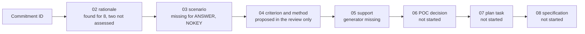

# SPRINT-003 alignment: coverage by commitment

This page belongs to the [SPRINT-003 alignment report](03.7-sprint-003-alignment-report.md). For each commitment in the [brief](03.6-sprint-003-review-brief.md) and its [addendum](03.6.3-sprint-003-brief-addendum.md) it records what the four first-pass reviews found, in a few words, and points to the review that holds the detail.

*The chain every commitment must complete. The first four links were assessed for eight commitments; the last three have not begun.*

## Upstream view: stages 02 to 05

Sources: [02 Purpose](../02-purpose/03.1-sprint-003-purpose-review.md), [03 Use Cases](../03-system-model-and-use-cases/03-sprint-003-use-case-review.md), [04 Evaluation](../04-benchmarks-and-eval-strategy/03.5-sprint-003-evaluation-review.md) and [05 Architecture](../05-high-level-design-and-architecture/03.1-sprint-003-architecture-review.md). C numbers refer to the [conflicts page](03.7.2-sprint-003-conflicts.md).

| ID | 02 Purpose rationale | 03 Scenario or obligation | 04 Criterion and method | 05 Architectural support |
| --- | --- | --- | --- | --- |
| S003-LAYOUT | Attention first: the cue stays the largest signal. Supported. | UC-04 behavior unchanged; several controls unplaced (C9). | No criterion today. Proposed: scripted page check, cue same size or larger. | The cue lives in the page alone; element IDs are a contract with the page check. |
| S003-PREVIEW | Pablo judges the layout before it replaces a display he finds useful. | An acceptance step, not a use case; show every state (C10). | A dated approval naming the exact preview. | Nothing today. Proposed: a static page inside sprint scope. |
| S003-GLANCE | "At a glance", "short text". The criterion omits the answer (C7). | Partly covered by UC-01 and UC-04; nothing on a fourth element. | "At a glance" is undefined. Proposed: sizes relative to today, Pablo's own check. | Complete updates and a length limit, now for short bullets. |
| S003-ANSWER | "A few relevant points" for his own answer. The deferral it contradicted is lifted (C1). | No scenario exists (C5, C6). Always replaced on Confirm (C4, decided). | No usable criteria. Proposed: function by tests, quality by human review. | Focus already has a version and one writer; the answer generator is missing. |
| S003-NOKEY | The cue must not depend on the new capability. | No scenario; "still works" is assumed, not decided (C2). | Nothing today. Proposed: deterministic test and page check. | `/health` reports the key; the start script needs the key file (C3). |
| S003-TESTS | Technical: guards "never overwrites the question". | Traces to the UC-04 alternatives. | Exit 0, existing cases pass, no OpenAI call. The page is not reached (C11). | The generator is injected like today's model call. |
| S003-RUN | Technical: shortens today's start workflow. | Traces to the UC-04 precondition "session is ready". | Scripted shell check: start, reuse, port held by another program. | One service on one port; `/health` must identify the service and its start (C14). |
| S003-LIVE | Only a live session shows whether attention is preserved. | No use case; walk the main flow and one replacement. | A scripted session; the pass rule is not agreed (C8). | Audit events and render acknowledgements exist; answer events to add. |
| S003-DETAILS | Not assessed. The review warned that fuller wording strains the glance constraint (C17). | Not assessed. | Not assessed; no readability check for a details area. | Not assessed. One call for both parts ties the bullets to the slower output (C5). |
| S003-CONTEXT | Not assessed. No Purpose page covers personal material sent to OpenAI (C12). | Not assessed. UC-03 already models recall from user-provided context. | Not assessed. The review asks that answers be checked against declared context. | Not assessed. A new input that needs a data decision and a Git-ignored place in scope (C18). |

## What the table shows

The first eight commitments each have a Purpose rationale, and no stage found a reason to change one.
S003-ANSWER and S003-NOKEY have no scenario in Stage 03, and the Stage 04 criteria and methods exist only as proposals inside its review.
Architecture can carry the sprint with one new part, the answer generator in the local service; its documents still describe an older page.
The last two rows quote what the reviews said before Pablo decided. They are pointers for the owners, not assessments.
The reverse check found three additions that no sprint criterion names: handling a failed answer request (C6), a start marker on `/health` (C14) and the scripted page check (C11). Each traces to a commitment or the attention constraint and needs its owner's decision before it enters the plan.

## Downstream view: stages 06 to 08

| ID | 06 POC decision | 07 plan task | 08 specification scenario |
| --- | --- | --- | --- |
| All ten | Not started. One candidate question: the delay from Confirm to a visible answer (C5). | Not started. | Not started. No SPRINT-003 design or OpenSpec change exists. |

Return to the [alignment report](03.7-sprint-003-alignment-report.md) or to [Planning](README.md).
