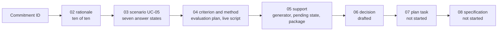

# SPRINT-003 alignment: coverage by commitment, version 3

This page belongs to the [SPRINT-003 alignment report](03.7-sprint-003-alignment-report.md). For each of the ten commitments it records what each stage now holds, after the correction round, and the hashes the recheck read. Version 2 is in Git commit `112cad2`.

*The chain every commitment must complete. Version 2 had the first four links partly missing; they now exist as drafts, and the last two have not begun.*

## Stages 02 to 06 by commitment

| ID | 02 Purpose | 03 Use Cases | 04 Evaluation | 05 Architecture |
| --- | --- | --- | --- | --- |
| S003-LAYOUT | Attention first; unchanged | UC-04 unchanged; controls left to the preview (C9) | Layer 2 and 3 checks; glance check | Cue stays in the page; IDs are a contract |
| S003-PREVIEW | Unchanged | Seven states for the preview | Dated approval naming files by hash | Static page in scope, proposed |
| S003-GLANCE | Details outside the glance path (proposed, 03.2) | Same | Four elements; details excluded | Length limits |
| S003-ANSWER | Deferral lifted in 03-planned-improvements | UC-05 written | Function by tests, quality by Pablo's review | Separate generator; 01.3 |
| S003-DETAILS | Proposed boundary, 03.2 | UC-05, collapsed when long | Readability check N3 | Same call; bullets wait (C5) |
| S003-CONTEXT | Boundaries B1 to B5 proposed, 03.2 | Package, no-package case | No-benchmark check | Package page, data statements |
| S003-NOKEY | Cue independent | Minimal page decided (C2) | Unavailable state check | `/health`; start without key proposed |
| S003-TESTS | Technical | Traces to UC-05 | Layers 1 and 2 | Injected generator |
| S003-RUN | Technical | Precondition | Shell check | Decision path in 01.4 |
| S003-LIVE | Attention evidence | Seven-step script | Pass rule decided 18 November | Audit events, delay points |

The 06 POC decision, [03.1](../06-viable-proof-of-concept/03.1-sprint-003-poc-decision.md), records Pablo's choice to learn the answer delay in the live session; it exists for all ten commitments, and 07 and 08 hold nothing. No SPRINT-003 OpenSpec change exists: `openspec/changes/` holds only the UC-04 change and an archive.
Not yet visible in the pages: 02 and 05 still call several accepted defaults proposals, and 03's pages A03-2 to A03-4 were not found changed.

## Hashes read in this recheck

| Page | Version 2 | Version 3 |
| --- | --- | --- |
| 02 review | `afc8c4c6…9e01882c` | `77b949f6762cf1c6df07049cd7bf506b4e4db4ac01b76b19232f7834635abcd7` |
| 03 review | `a73f5318…0ee2a057` | `ddacb92fd43f393ba0114a85346eeb624914b56f01f5e5c6a80601d07130f23b` |
| 04 review | `b5010a00…2822acf8` | `3eccae7a12b13c814891f3373f55ffaf715e06ed3bd7fa579b67cedcee491999` |
| 05 review | `93894a2f…4d4565f2` | `35dd2ebc151ea0a44eff003b860a145ea79a47f7e60c7bf22d7fc08f090a0532` |
| 02 planned improvements | not recorded | `5db338cbf61e85f144b20173a2054630ccd3487bcd9929b0c6a00b68b324e016` |
| 02 prepared-context proposal | new | `ff708fe968b09466cd3257ee90e9ee4da55e6c2ed7003176bd48ed933c323e15` |
| 03 UC-05 and its states | new | `9f960527…94cd1cff` and `c5412634…1fe8fc33` |
| 04 evaluation plan and live session | new | `c5cca0f5…31a023e4` and `bc165bed…86d97708` |
| 05 proposed answer, pending state | new | `5e436b04…7e2fc7e8` and `a39151f7…7441140d` |
| 05 package decision, data statements | new | `ff5a0ea9…08b6bc11` and `67e56589…b2fb6e1d` |
| 06 POC decision | not recorded | `3262517e…998de095` |

Short forms hide the middle of a hash; the abbreviated rows use its first and last eight characters and were read from the files on 18 November 2026. Return to the [alignment report](03.7-sprint-003-alignment-report.md) or to [Planning](README.md).
