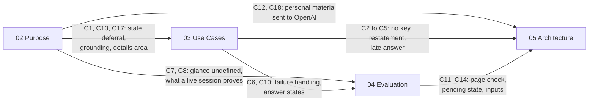

# SPRINT-003 alignment: conflicts and gaps between stages

This page belongs to the [SPRINT-003 alignment report](03.7-sprint-003-alignment-report.md). It compares the four first-pass reviews by meaning, applies Pablo's answers from the [brief addendum](03.6.3-sprint-003-brief-addendum.md), and lists every disagreement or gap with the role that owns its correction. Nothing here has been corrected yet.

*The six relationships that must hold, each labelled with the items that keep it from holding today.*

## The six relationships

| Relationship | State after the first pass and Pablo's answers |
| --- | --- |
| Purpose → Use Cases | The goal fits the purpose, but Purpose still defers suggested answers and the answer scenario does not exist. |
| Purpose → Evaluation | Passing today's criteria would not show the benefit: none covers a proposed answer, and one session cannot show that it helps. |
| Purpose → Architecture | The key stays in the local service. A prepared context will now leave the Mac, and neither stage's documents cover that. |
| Use Cases → Evaluation | Evaluation lists the observations it needs, but Stage 03 has no scenario to supply them and the two state lists differ. |
| Use Cases → Architecture | Version binding delivers show, replace and discard, which matches "always replace". The no-key meaning and late answers are unresolved. |
| Evaluation → Architecture | Closest to holding: version, render acknowledgement and an injectable generator are offered. A pending state and inspectable inputs are not yet explicit. |

## Numbered items

| # | Disagreement or gap | Owner | State |
| --- | --- | --- | --- |
| C1 | Purpose defers suggested answers; Stage 03, 04 and 05 pages repeat it. Pablo's direction and his S003-Q3 answer lift the deferral in full. | 02 first, then 03, 04, 05 | Decided; amend |
| C2 | "The page still works" without a key. Today the service refuses the session, so no question is captured. A minimal reading is assumed: page, timer, cue and a clear message. | Pablo, then 03 and 05 | Assumed; being confirmed |
| C3 | `poc/start.sh` passes `--env-file=.env.local`. 05 says it cannot start without that file; 03 could not establish it. The file is absent in this checkout. | 05, then 08 | Open; needs one observed run |
| C4 | A confirmed restatement: "Yes, always replace". UC-04 keeps a restatement in the same exchange and UC-02 asks for stable anchors, so Stage 03 must reconcile them. | 03 | Decided; amend |
| C5 | No acceptable delay for an answer, and no rule for one that arrives after Pablo starts speaking. One call now produces bullets and details, so the bullets wait for the longer output. | 03 for behavior, 06 for the POC decision | Open |
| C6 | No sprint criterion covers a failed answer request. 03 leaves retry undecided; 04 assumes a bounded number of retries. | 03 | Open |
| C7 | Criterion 2 omits the answer card and the details area, names no viewing surface, and "at a glance" has no definition. | 04; Pablo for the surface | Amend, plus one decision |
| C8 | 02 expects the live session to show whether attention is preserved; 04 says one session shows that it works, not that it helps. No pass rule is agreed. | 04, with Pablo's agreement | Decision |
| C9 | Layout B does not place Clear live, Start and Stop listening, the manual cue buttons or the status panels. | Pablo, through the preview; then 08 | Open |
| C10 | Preview content: 03 draws seven answer states, 04 lists four. 05 proposes a static page under `poc/` or `images/`. | 03 for the states, 04 for the preview set | Amend |
| C11 | Criterion 5 names only `node --test`, which does not reach the page; layout and glance need the scripted page check. | 04, then the 07 plan | Open |
| C12 | Personal material sent to OpenAI: decided, as an interview preparation package. No Purpose boundary covers it and the capture-and-data choice in Stage 05 is open. | 02 and 05 | Decided; amend |
| C13 | Purpose does not say an answer must never present invented experience; 03, 04 and 05 already assume it. With a package, the rule becomes: nothing about him that the package does not contain. | 02, with Pablo's agreement | Amend |
| C14 | The design must make explicit: a pending state, inspectable request inputs, the answer kept as last known after Stop, and a start marker on `/health`. | 05, then 08 | Amend |
| C15 | Minor: whether Alice names the product or the agent; the test count is 19 in source and eighteen in `poc/docs/07`. | 02; 09 for the test count | Open |
| C16 | Sprint-record mismatch: S003-DETAILS and S003-CONTEXT are in no recorded criterion, and the details area amends the recorded layout decision. | Pablo, through the sprint process | Decision |
| C17 | The details area against the attention constraint: Purpose asks for short text at a glance, and no stage has assessed a second text area. | 02, then 03 and 04 | Not assessed |
| C18 | The context package: where it is kept, what leaves the Mac, the data statements in the root `AGENTS.md` and `poc/README.md`, and the exclusion of benchmark material. | 05 and 04; the two data statements have no assigned owner | Not assessed |

## Decided, carried forward and assumed

Decided by Pablo on 16 November: inputs (C1, C12), form (short bullets plus a details area) and restatement (C4).
Carried forward: S003-Q2. Criterion 3 as approved reads as automatic, and 03, 04 and 05 design for it.
Assumed, not decided: the reading of criterion 4 (C2).

Return to the [alignment report](03.7-sprint-003-alignment-report.md) or to [Planning](README.md).
