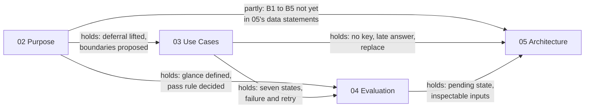

# SPRINT-003 alignment: conflicts and gaps between stages, version 3

This page belongs to the [SPRINT-003 alignment report](03.7-sprint-003-alignment-report.md). It rechecks the six relationships between stages against the pages written in the correction round and updates each of the eighteen items. "Decided" below rests on 00 Governance's relay of Pablo's answers of 16 and 18 November 2026; Planning did not see them.

*The six relationships. Five hold in the drafts; the one from Purpose to Architecture waits on the owners and the data statements.*

## The six relationships

| Relationship | State now (18 November 2026) |
| --- | --- |
| Purpose → Use Cases | **Holds.** The deferral is lifted in [planned improvements](../02-purpose/03-planned-improvements.md); UC-05 exists. Purpose's boundary sentences remain proposals. |
| Purpose → Evaluation | **Holds.** The [glance check](../04-benchmarks-and-eval-strategy/01.2-evaluation-criteria.md) and the live pass rule exist; one session still cannot show benefit, and the plan says so. |
| Purpose → Architecture | **Partly holds.** Both keep the key local and send the package text. Purpose's B2 (tell Pablo before a session) appears in no architecture page. |
| Use Cases → Evaluation | **Holds.** Both use the same seven [answer states](../03-system-model-and-use-cases/01.5.1-proposed-answer-states.md). |
| Use Cases → Architecture | **Holds.** Replace on every Focus change, the no-key page, one retry and last known after Stop agree. |
| Evaluation → Architecture | **Holds.** The [pending state and inspectable inputs](../05-high-level-design-and-architecture/01.5-pending-state-and-inspectable-inputs.md) answer the checks. |

## Numbered items

| # | Item | Owner | State now |
| --- | --- | --- | --- |
| C1 | Stale deferral | 02, 03, 04, 05 | Decided; the Purpose deferral is lifted; no other page found still deferring |
| C2 | No-key meaning | 03, 05 | Decided 18 November: key put in place, minimal page as fallback |
| C3 | Start without the key file | 05, 08 | Open: `poc/.env.local` now exists here; the no-file start was not run, and Node 24.22.1 exits 9 on a missing `--env-file` |
| C4 | Restatement | 03 | Decided and applied in UC-05 |
| C5 | Delay and late answer | 03, 06 | Decided: learn it in the live session; late answer shown silently; limits provisional |
| C6 | Failed request | 03 | Decided: one service retry, then a message, no button |
| C7 | Criterion 2 and glance | 04 | Applied in the criteria; the criterion text is in the [amendment](03.7.4-sprint-003-record-amendment.md) |
| C8 | Live pass rule | 04 | Decided 18 November |
| C9 | Controls in layout B | Pablo, 08 | Open by design: the preview proposes them |
| C10 | Preview states | 03, 04 | Applied: seven states, Shown twice |
| C11 | Page check | 04, 07 | Planned in the evaluation plan; not in a sprint criterion; needs 07 |
| C12 | Package boundary | 02, 05 | Drafts exist; Purpose B1 to B5 and 05's package page await "decided" |
| C13 | No invented experience | 02 | Sentence proposed in 03.2; a near-equivalent stands in `01-purpose.md` |
| C14 | Pending state, inputs, marker | 05, 08 | Applied in 01.5 as design; nothing built |
| C15 | Product name, test count | 02, 09 | Open; minor |
| C16 | Sprint-record mismatch | Pablo | Open: [route proposed](03.7.4-sprint-003-record-amendment.md) |
| C17 | Details area and glance | 02, 03, 04 | Decided 18 November: acceptable as a second text area, collapsed when long; live attention check |
| C18 | Context package and data statements | 05, 04, N5 | Package place and wording drafted; the two statements have no owner |

## Decided, assumed and open

Decided: C1, C2, C4, C5, C6, C8, C17. Assumed: none left; the no-key reading was confirmed. Open: C3, C9, C11, C15, C16 and the data statements in C18.
Planning found no contradiction between two stages' drafts. The residual risk is status wording: 02 and 05 still describe accepted defaults as proposals.

Return to the [alignment report](03.7-sprint-003-alignment-report.md) or to [Planning](README.md).
