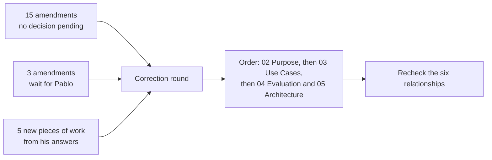

# SPRINT-003 alignment: proposed amendments

This page belongs to the [SPRINT-003 alignment report](03.7-sprint-003-alignment-report.md). It lists the eighteen changes the four reviewing stages proposed to their own documents, and the work Pablo's later answers add. None has been applied; each owner applies its own in the correction round.

*His answers on inputs, form and restatement released five amendments. All eighteen were written before those answers and must now reflect them.*

## No decision pending

| ID | Owner and file | Change |
| --- | --- | --- |
| A02-1 | 02, `03-planned-improvements.md` | Replace the next improvement and the deferral with the SPRINT-003 outcome. The deferral is lifted in full. |
| A02-2 | 02, same file | Add acceptance questions for the proposed answer. Apply with A02-1. |
| A02-4 | 02, `02-current-capabilities.md`, `README.md` | Point to what the page does today; say the sprint record calls the product Alice. Can wait for closeout. |
| A03-2 | 03, `01.4-confirm-current-question.md` | Correct "the two-area panel is not implemented"; layout B moves the areas without changing their rules. The picture waits for the approved preview. |
| A03-3 | 03, `01-system-model.md`, `system-use-cases.puml` and its two images | Name Alice, cite SPRINT-003, link the new scenario once A03-1 exists. |
| A03-4 | 03, `01.1`, `01.2`, `01.3`, `README.md` | State what SPRINT-003 selects; résumé-based recall is no longer deferred for interviews. |
| A04-1 | 04, `01.2-evaluation-criteria.md` | Proposed-answer criteria for short bullets grounded in the package, and a definition of the glance check. |
| A04-2 | 04, `01-evaluation-strategy.md` | Link those criteria; name the generator and its declared inputs under input isolation. |
| A04-4 | 04, `02-evidence-and-reconciliation.md` | A dated update: the page now has the Focus and Live panel, Confirm, Clear live and the local service. |
| A04-5 | 04, `03.2-release-alternatives-and-review-decisions.md`, `README.md` | The live attention rubric and hint criteria are now due; add links. |
| A05-1 | 05, `02-current-architecture.md` | Rewrite for revision `7d60c0f`: the service, transcription, agent and retained question now exist. |
| A05-2 | 05, `01-architecture.md`, `README.md` | Replace "answer suggestions remain later"; add the answer generator and the page states with and without a key. |
| A05-3 | 05, `01.1-streaming-and-replay.md` | Allow one request of each kind at a time; add the answer request and result with their Focus version. |
| A05-4 | 05, `01.2-interview-state.md` | Add the proposed answer to the session information, tied to the Focus version and replaced on every Confirm. |
| A05-5 | 05, `03-planned-decisions.md` and a new decision package | Where answers are generated, and what leaves the Mac now that a package is sent. |

## Still waiting

| ID | Owner and file | Change | Waits for |
| --- | --- | --- | --- |
| A02-3 | 02, `01-purpose.md` | One sentence: a proposed answer never presents invented experience as his. | Pablo's agreement to a new boundary (C13) |
| A03-1 | 03, new `01.5-proposed-answer.md` | The missing scenario, with its flow and alternatives. | The criterion 4 reading (C2); it can be drafted on the assumption |
| A04-3 | 04, new `03.6-sprint-003-evaluation-plan.md` | The checks, preview state set, latency definition, live script and pass rule. | The live pass rule (C8) |

## New work from Pablo's answers

No owner has proposed these yet, because the reviews came first. Planning lists them and assigns none.

| ID | Likely owner | Work | Item |
| --- | --- | --- | --- |
| N1 | 02 | A boundary for a prepared context sent to OpenAI, and whether a details area fits "short text". | C12, C17 |
| N2 | 03 | The details area, the package and "always replace" in the new scenario. | C4, C17 |
| N3 | 04 | Readability of the details area, grounding against the package, and a check that it holds no benchmark material. | C7, C18 |
| N4 | 05 | Where the package is kept, outside Git and inside sprint scope, and what one call for both parts does to the delay. | C5, C18 |
| N5 | Not assigned | The data statements in the root `AGENTS.md` and `poc/README.md`. | C18 |

## Checks on the list

No two owners would edit the same file: every amendment stays in its owner's stage folder, and none changes the sprint record, a criterion or another stage's page.
Stage 04's new page and Planning's brief are both named `03.6-…`, in different folders, so they do not collide.
N5 falls outside the four stage folders, and `poc/README.md` is application documentation inside the sprint gate.
Each amended page is a new version that carries no earlier acceptance. Return to the [alignment report](03.7-sprint-003-alignment-report.md) or to [Planning](README.md).
