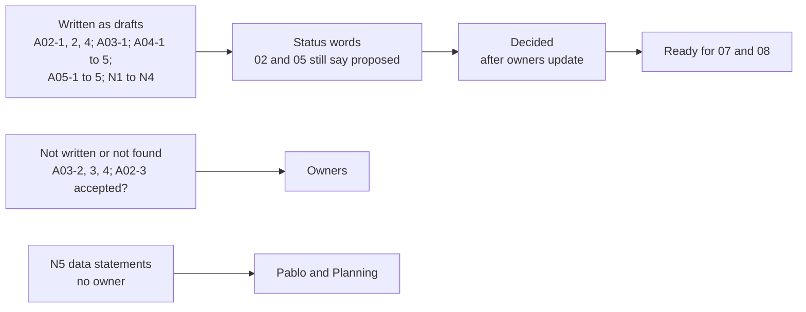

# SPRINT-003 alignment: amendments and what is left, version 3

This page belongs to the [SPRINT-003 alignment report](03.7-sprint-003-alignment-report.md). It follows the eighteen amendments proposed by the four stages and the five new pieces of work (N1 to N5) through the correction round. "Written" means the owner saved a draft; none is accepted.

*The correction round wrote most amendments. What remains is status wording, three Stage 03 edits and N5.*

## Applied as drafts

| ID | Evidence |
| --- | --- |
| A02-1, A02-2, A02-4 | [Planned improvements](../02-purpose/03-planned-improvements.md), [current capabilities](../02-purpose/02-current-capabilities.md), [README](../02-purpose/README.md) |
| A03-1 | [UC-05](../03-system-model-and-use-cases/01.5-proposed-answer.md) and its [states](../03-system-model-and-use-cases/01.5.1-proposed-answer-states.md) |
| A04-1 to A04-3 | [Criteria](../04-benchmarks-and-eval-strategy/01.2-evaluation-criteria.md), [strategy](../04-benchmarks-and-eval-strategy/01-evaluation-strategy.md), [evaluation plan](../04-benchmarks-and-eval-strategy/03.6-sprint-003-evaluation-plan.md) |
| A05-1 to A05-5 | [Current architecture](../05-high-level-design-and-architecture/02-current-architecture.md), [proposed answer](../05-high-level-design-and-architecture/01.3-proposed-answer.md), [planned decisions](../05-high-level-design-and-architecture/03-planned-decisions.md), [package decision](../05-high-level-design-and-architecture/decisions/Proposed%20answer%20and%20its%20context/README.md) |
| N1 to N4 | [Purpose proposal](../02-purpose/03.2-sprint-003-prepared-context-proposal.md), UC-05, the details and package checks of the evaluation plan, and [pending state and inputs](../05-high-level-design-and-architecture/01.5-pending-state-and-inspectable-inputs.md) |

## Still open

| ID | Owner | What remains |
| --- | --- | --- |
| A02-3 | 02, Pablo | The invented-experience sentence is proposed in 03.2; accepting it replaces the draft in `01-purpose.md`. |
| A03-2, A03-3, A03-4 | 03 | Files unchanged since the baseline commit; Planning did not verify whether they already hold the edits. The picture waits for the preview. |
| A04-4, A04-5 | 04 | Not found in the changed list; Planning did not read those pages. |
| Status | 02, 05 | Mark the accepted defaults decided in their own folders; 03 and 04 already do. |
| N5 | none | The root `AGENTS.md` and `poc/README.md` data statements. |

## N5: the data statements

Architecture wrote the exact wording in its [data statements](../05-high-level-design-and-architecture/decisions/Proposed%20answer%20and%20its%20context/03-data-statements.md); it applies none, because it owns neither page, and says they belong in the same change as the code.
Root `AGENTS.md` is project guidance outside the sprint gate, so a human can edit it any time. `poc/README.md` is inside scope `poc/`, so only active implementation permission edits it. Both should change with the feature, not before: today's text is correct until the package is sent.
Planning proposes that Pablo assign the root `AGENTS.md` sentence to 00 Governance, and `poc/README.md` to 09 Coding under the amended sprint, as part of criterion 9.

Return to the [alignment report](03.7-sprint-003-alignment-report.md) or to [Planning](README.md).
