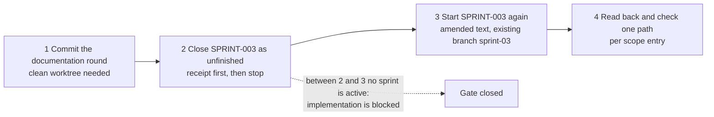

# SPRINT-003 record amendment: what Pablo needs, and the cleanest route

This page belongs to the [SPRINT-003 alignment report](03.7-sprint-003-alignment-report.md). It is a draft for Pablo, the project owner, and it decides nothing. It is the exact text that would add S003-DETAILS and S003-CONTEXT to the sprint record, and the human route to get it there. Planning ran no sprint command and edited no `.asdg/` state.

*The only route the commands allow. There is no amend command, only `sprint start` and `sprint stop`, and start refuses while a sprint is active.*

## Why the record needs amending

The recorded sprint, [snapshot](03.7-sprint-003-alignment-report.md) SHA-256 `c81510f030ff0e85aa758a7145477807739839bd9e2943dcf36a062850e1ddc4`, holds one objective, seven scope entries and seven criteria. None mentions a details area or a prepared context, and S003-LAYOUT as recorded has no details area.
Pablo decided both on 16 November and said on 18 November that he triggers the amendment himself. Without it, coding would meet criteria that omit two of his decisions. The scope needs no change: `poc/` already holds the package folder `poc/context/interview/`, and the stage pages are documentation outside the gate.

## Proposed text

Objective: *Give Alice a new page design and let her propose an answer to the Focus question: a few short points beside it and supporting details below, built from the question and an interview preparation package.*
Scope: the seven entries of today's record, unchanged: `index.html`, `index.md`, `app.js`, `app.md`, `images/`, `poc/`, `openspec/changes/`.

| # | Criterion | Change |
| --- | --- | --- |
| 1 | Pablo approves the new page layout from a preview before it replaces the current page. | Unchanged |
| 2 | The Focus question, the Live question, the proposed-answer points and the GOOD / LAND IT / STOP cue stay readable at a glance in the new layout, and the details area never shrinks, covers or moves them. | Adds the answer card and the details rule (C7, C17) |
| 3 | When a Focus question is confirmed, Alice shows a proposed answer for it: at most three short points beside the question and details below, from one model call. Any change to the Focus question, a confirmed rewording included, replaces both. The answer never overwrites the question. | Adds the form and "always replace" |
| 4 | Without an OpenAI key the page still loads, the timer and cue work, and a clear message says question recognition and proposed answers are unavailable. | Words Pablo's accepted reading (C2) |
| 5 | `node --test poc/poc.test.mjs` passes, with new tests for the proposed answer, and the scripted page check passes for all seven answer states. | Adds the page check (C11); needs Pablo's yes |
| 6 | `bash poc/alice-run.sh` starts the server or reuses one already running. | Unchanged |
| 7 | Pablo runs one live session following the live-session script and the result is recorded as pass or fail by the pass rule he decided on 18 November. | Names script and rule |
| 8 | S003-DETAILS: a details area below the cards shows supporting details from the same call as the points; it is read on demand, scrolls only inside itself and causes no motion or sound. | New |
| 9 | S003-CONTEXT: the answer is built from the question and the package in the Git-ignored `poc/context/interview/` (plain text or Markdown, up to 20,000 characters); only those are sent to OpenAI; the package never holds benchmark recordings, evaluator labels or reference answers; with no package the points are general and say so; and the data statements in the root `AGENTS.md` and `poc/README.md` match. | New; includes N5 |

Items 4, 5 and 9 reach beyond the addendum's words. Criterion 5 is the only one that adds work Pablo has not named; he may drop it.

## Route and risks

Planning recommends the route in the diagram, reusing the ID so that the many stage pages citing SPRINT-003 stay true. The human runs it, or says so to [Sprint close](../../../asdg/skills/asdg-sprint-close/SKILL.md) and [Sprint start](../../../asdg/skills/asdg-sprint-start/SKILL.md).

| Risk | Effect | Mitigation |
| --- | --- | --- |
| Start requires an empty `git status`, untracked files included | 29 changes are waiting today, so start would stop with `BLOCKED: GIT_WORKTREE_DIRTY` | Pablo commits the round first; nobody stages or stashes for him |
| The branch `sprint-03` exists | Start must not reuse a name silently | He states the reuse explicitly, or names a new branch |
| Closing as `unfinished` records no success | The old criteria stay open in the receipt, which is true | Receipt first, with carry-forward: the amended restart |
| Same ID twice | A second receipt for SPRINT-003 could confuse a reader | A new ID, such as SPRINT-004, avoids it but makes every stage page cite the old one |
| No active sprint between stop and start | Any application edit is blocked in that window | Nothing is being coded; keep it short |
| Hook trust is not assessed | The gate is behavioral until a human trusts the hooks | Unchanged by this route |
| Documents under `docs/asdg/` cannot be in scope | The CLI rejects that path | Already the case; stage pages stay outside the gate |

Alternative: leave the record as it is and treat the addendum as direction. It is cheapest, and the live-session pass rule still reaches both commitments, but the record keeps two decisions it does not mention.
This is a proposal; the bytes are unreviewed and approve nothing. Return to [Planning](README.md).
