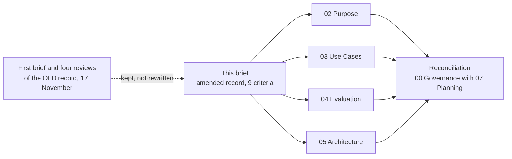

# SPRINT-003 review brief, version 2: the amended baseline

SPRINT-003 gives Alice (Alice.Good.Meetings) a new page layout and a proposed answer to the Focus question: a few short points beside it, supporting details below, built from the question and Pablo's interview preparation package.
The sprint was closed as unfinished and restarted with an amended record. Stages 02, 03, 04 and 05 each review this same baseline separately; all four receive this text unchanged. It replaces the [first brief](03.6-sprint-003-review-brief.md), whose bytes are kept.

*The old reviews are history. Each stage writes a new first report from this baseline before seeing the others' conclusions.*

## The baseline

| Item | Value |
| --- | --- |
| Sprint | SPRINT-003, restarted and active; bound by 00 Governance on 18 November 2026 at 17:45:48 UTC |
| Snapshot | `.asdg/sprint.json`, SHA-256 `90d6dab6bb3d43b1b16d71a153796a27c3c757339a4291682d7d979b05d69131` |
| Git | Branch `sprint-03`, HEAD `fe3c00edc3ca4008b0b203317593acb6ab87e851`; the snapshot is the only uncommitted change |
| Old record | Closed as unfinished; receipt `.asdg/sprint-closeouts/fc5b4f9b-6881-48a8-ab7a-95d722f11290.json`, SHA-256 `76b211727ae4b4a692f9f9947be47d2864aaa1f2bc1046fbff02723b1edc1efc` |
| Objective | "Give Alice a new page design and let her propose an answer to the Focus question: a few short points beside it and supporting details below, built from the question and an interview preparation package." |
| Scope | Unchanged: `index.html`, `index.md`, `app.js`, `app.md`, `images/`, `poc/`, `openspec/changes/` |

The nine criteria are the text of the [record amendment](03.7.4-sprint-003-record-amendment.md), which Pablo accepted by starting the sprint. They are quoted in the table below in short form; the snapshot is exact.

## Commitments

| ID | Commitment | Criterion | Against the old record |
| --- | --- | --- | --- |
| S003-LAYOUT | Layout "B, cue first": cue color and word as today; Focus and answer cards; Live bar with Confirm | 1, 2 | Unchanged decision |
| S003-PREVIEW | Pablo approves the layout from a preview before it replaces the page | 1 | Unchanged |
| S003-GLANCE | Focus, Live, answer points and cue readable at a glance; details never shrink, cover or move them | 2 | Changed: adds the points and the details rule |
| S003-ANSWER | On Confirm, at most three points beside the question and details below, one model call; any Focus change replaces both | 3 | Changed: trigger, count, call and replacement |
| S003-NOKEY | No key: page loads, timer and cue work, a message says recognition and answers are unavailable | 4 | Changed: exact wording |
| S003-TESTS | `node --test poc/poc.test.mjs` passes with new tests | 5 | Changed: adds the page check |
| S003-PAGECHECK | The scripted page check passes for all seven answer states | 5 | New; Pablo may drop it |
| S003-RUN | `bash poc/alice-run.sh` starts the server or reuses one | 6 | Unchanged |
| S003-LIVE | One live session by the script, pass or fail by the 18 November pass rule | 7 | Changed: script and rule named |
| S003-DETAILS | Details area from the same call; read on demand; scrolls inside itself; no motion or sound | 8 | New |
| S003-CONTEXT | Package in the Git-ignored `poc/context/interview/`, 20,000 characters; only it and the question sent; no benchmark material; general points without it | 9 | New |
| S003-STATEMENTS | The data statements in the root `AGENTS.md` and `poc/README.md` match what is sent | 9 | New; item N5, no stage owner |

Direction, constraints and the exact dates are in [direction and constraints](03.8.1-sprint-003-brief-v2-direction.md). How to use the first reviews is in [prior reviews](03.8.2-sprint-003-brief-v2-prior-reviews.md). Exact sources are on [02 and 03](03.8.3-sprint-003-brief-v2-sources.md) and [04, 05, 06 and shared files](03.8.4-sprint-003-brief-v2-sources-04-06.md).

## What each stage returns

Save one report in your own stage folder, under a new name; keep the 17 November report as it is. The first pass is read-only: propose amendments, do not apply them.
State this baseline, the IDs you cover, and the sources and hashes you relied on. Name missing, contradictory or ambiguous content, and each required amendment or an evidenced no-change conclusion, with the effect on later stages.
Technical items (S003-TESTS, S003-PAGECHECK, S003-RUN, S003-STATEMENTS) trace to an existing workflow, quality need or operating rule, not to a new feature.
Pages written in the correction round are drafts with no recorded acceptance; "Accept all" is 00 Governance's relay.
End with one verdict: `ALIGNED`, `CHANGE_REQUIRED`, `NEEDS_DECISION` or `MISSING_EVIDENCE`.

## Status

Prepared by 07 Planning on 18 November 2026 for the run that 00 Governance coordinates at Pablo's request, under the [review method](../../../asdg/skills/asdg-sprint-align/reviews.md). It assesses no stage, approves nothing, changes no sprint state and starts no coding. Return to [Planning](README.md).
