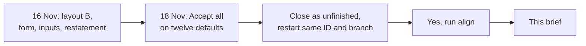

# SPRINT-003 brief v2: direction and constraints

This page belongs to the [version 2 review brief](03.8-sprint-003-review-brief-v2.md). It gives Pablo's current explicit direction with dates, and the limits every stage must respect. Where it differs from the first brief's [direction page](03.6.1-sprint-003-brief-direction.md), this page is newer and prevails.

*Direction arrives through 00 Governance. Planning did not see Pablo's original messages.*

## Pablo's direction

| Date | Direction, as relayed | Where it is recorded |
| --- | --- | --- |
| 16 November 2026 | Layout "B, cue first"; short bullets beside the question and a details area below, one call for both; a prepared context, for interviews an interview preparation package of his résumé and other documents, sent to OpenAI; "Yes, always replace" on any Focus change. His own words, typos included, are in the [addendum](03.6.3-sprint-003-brief-addendum.md) | Addendum; sprint criteria 3, 8 and 9 |
| 16 November 2026 | Accepted defaults: at most three bullets; details read on demand; a late answer shown silently; a failed request shown as a message; general points without a package; last known after Stop; "learn the delay in the live session" | Use Cases UC-05; Evaluation plan; 06 decision |
| 18 November 2026 | "Accept all" on the consolidated list of twelve recommended defaults, including the package folder, format and limit, one service retry, the details area as a second text area, the key put in place with the minimal no-key page as fallback, and the live pass rule | Stage pages, by their status words as owners update them |
| 18 November 2026 | The sprint record is amended to add S003-DETAILS and S003-CONTEXT; "Yes, start it", with the same ID and branch | Snapshot and closeout receipt |
| 18 November 2026 | "Yes, run align" | This run |

The live pass rule: every step meets its expectation, no answer for an earlier question is shown, every statement about him is in the package, he takes in the cue, Focus and bullets at a glance, and he would keep the answer on in a real interview. Delay and fit are reported, not part of the rule. He alone judges statements about himself.
Where a page still calls an accepted default a proposal, treat Pablo's relayed acceptance as the direction and flag the wording. A changed page inherits no earlier acceptance.

## Constraints

- Attention first: guidance is brief and glanceable; the cue stays the strongest signal ([Purpose](../02-purpose/01-purpose.md)).
- The key lives only in `poc/.env.local`, which Git ignores; never print or commit it.
- While listening, audio and selected transcript text go to OpenAI; each confirmed question also sends the question and the package text.
- The package never holds benchmark recordings, evaluator labels or reference answers; no analysis component may reach future audio, private transcripts or reference answers.
- `poc/browser-smoke.mjs` and the live session are billable; use synthetic speech or fresh questions, never the benchmark recording.
- Review documents, not code: nothing is run, no OpenAI request made, no package text copied into any report.
- Stage documents under `docs/asdg/` cannot be in sprint scope. `poc/README.md` is gated; the root `AGENTS.md` is not.
- A passing check, an active sprint or a drafted page approves nothing; hook trust is not assessed.

Return to the [brief](03.8-sprint-003-review-brief-v2.md) or to [Planning](README.md).
