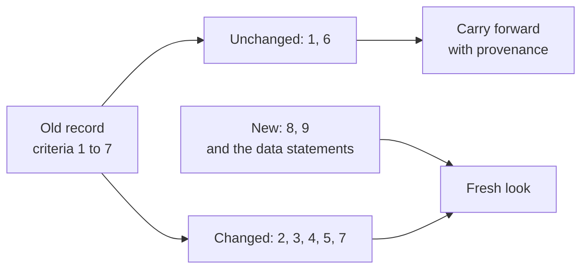

# SPRINT-003 brief v2: what the first reviews still tell us

This page belongs to the [version 2 review brief](03.8-sprint-003-review-brief-v2.md). The four first-pass reviews of 17 November 2026 assessed the OLD record: eight commitments and seven criteria, written before Pablo's answers. Their bytes are kept. This page says which conclusions carry forward and which need a fresh look.

*Criteria 1 and 6 are unchanged and carry forward; every other criterion needs a fresh look.*

## How to use them

A first review is evidence of what the owner read on 16 and 17 November, not of the present documents. Cite it with its path and hash, and re-read the current page before relying on any conclusion. Every verdict was `CHANGE_REQUIRED`, and the stage pages that answered it were rewritten afterwards.
**Hash note:** the hashes version 2 of the alignment report recorded for these files differ from the current bytes, and the cause is unestablished (see the [report](03.7-sprint-003-alignment-report.md)). The files are unchanged in Git since commit `112cad2`. The hashes below are the current ones. The carry-forward column is Planning's reading of each review's conclusion and the version 2 coverage page; each owner confirms or corrects it.

| Stage | Review and SHA-256 | Carries forward | Needs a fresh look |
| --- | --- | --- | --- |
| 02 | [Purpose review](../02-purpose/03.1-sprint-003-purpose-review.md), `77b949f6762cf1c6df07049cd7bf506b4e4db4ac01b76b19232f7834635abcd7` | The goal serves the product purpose (S003-LAYOUT, PREVIEW, RUN, TESTS) | The deferral finding, now corrected in drafts; S003-GLANCE, ANSWER, NOKEY, LIVE; S003-DETAILS and S003-CONTEXT, never assessed |
| 03 | [Use-case review](../03-system-model-and-use-cases/03-sprint-003-use-case-review.md), `ddacb92fd43f393ba0114a85346eeb624914b56f01f5e5c6a80601d07130f23b` | UC-04 behavior is unchanged under layout B (S003-LAYOUT, PREVIEW) | The missing answer scenario, now UC-05; no-key meaning; failure handling; the details area and package, never assessed |
| 04 | [Evaluation review](../04-benchmarks-and-eval-strategy/03.5-sprint-003-evaluation-review.md), `3eccae7a12b13c814891f3373f55ffaf715e06ed3bd7fa579b67cedcee491999` | S003-RUN as a shell check; existing cases must keep passing | Every criterion proposal, now an evaluation plan; the live pass rule; the page check; details and package checks |
| 05 | [Architecture review](../05-high-level-design-and-architecture/03.1-sprint-003-architecture-review.md), `35dd2ebc151ea0a44eff003b860a145ea79a47f7e60c7bf22d7fc08f090a0532` | One local service owns the key; the answer generator is a new part | Current-architecture wording; data flow and delay with the package; package location; `/health` marker |

## Unchanged and changed criteria

Unchanged in meaning: criterion 1 (preview) and criterion 6 (`bash poc/alice-run.sh`).
Changed: 2 (adds the answer card and the details rule), 3 (confirmed question, three points, one call, replacement), 4 (exact wording), 5 (adds the page check), 7 (script and pass rule).
New: 8 (details area) and 9 (package, what is sent, data statements).
The 17 November reviews have no assessment of 8, 9, S003-PAGECHECK or S003-STATEMENTS, and an evidenced "no change" there needs a fresh reading.

Return to the [brief](03.8-sprint-003-review-brief-v2.md) or to [Planning](README.md).
