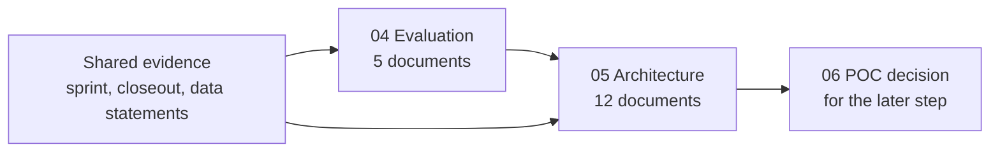

# SPRINT-003 brief v2: sources for stages 04, 05 and 06, and shared files

This reference page belongs to the [version 2 review brief](03.8-sprint-003-review-brief-v2.md). Hashes are SHA-256 of the files in the working tree on 18 November 2026 at Git HEAD `fe3c00edc3ca4008b0b203317593acb6ab87e851`. All stage documents are drafts with no recorded acceptance.

*The 06 page is listed so reviewers know it exists. It is not assessed in the first pass.*

## Stage documents to assess

| Stage | Document | Holds | SHA-256 |
| --- | --- | --- | --- |
| 04 | [01-evaluation-strategy.md](../04-benchmarks-and-eval-strategy/01-evaluation-strategy.md) | Strategy, input isolation | `31fff9f0a227170cbf4259a589902e0675e07441b68736ac955b75625af169af` |
| 04 | [01.2-evaluation-criteria.md](../04-benchmarks-and-eval-strategy/01.2-evaluation-criteria.md) | Scorecard, glance check | `d1a65a3632199f077da89fedb30d1fa55ea38a70f8a38beabb03e879b4f25980` |
| 04 | [02-evidence-and-reconciliation.md](../04-benchmarks-and-eval-strategy/02-evidence-and-reconciliation.md) | What was inspected | `d203468caabe50e1f2d2e60748b419125dbeeec4d754f087af51b94790281928` |
| 04 | [03.6-sprint-003-evaluation-plan.md](../04-benchmarks-and-eval-strategy/03.6-sprint-003-evaluation-plan.md) | Four layers of evidence | `c5cca0f5c55641c01b3adcde2bd49f8304d07085aa3ade6d1fbcb1fc31a023e4` |
| 04 | [03.6.1-sprint-003-live-session.md](../04-benchmarks-and-eval-strategy/03.6.1-sprint-003-live-session.md) | Live script and pass rule | `bc165bedcf9a0c0eb67bd58cb186c8a3f727bd90015dde025c7301e386d97708` |
| 05 | [01-architecture.md](../05-high-level-design-and-architecture/01-architecture.md) | Components and placement | `0d5057042d590024dd70d612914027601e00934ae526dbfafefed6f84a90bb94` |
| 05 | [01.1-streaming-and-replay.md](../05-high-level-design-and-architecture/01.1-streaming-and-replay.md) | Streaming, timing, recovery | `3efa36b6ff5c7ac7252227b277e0867d9426f997136e6119e5937aa8e326d4bd` |
| 05 | [01.2-interview-state.md](../05-high-level-design-and-architecture/01.2-interview-state.md) | Interview state | `3e448c586167e0a70e8f1e416934f3013c8b94552881513891f73b12e5ffd980` |
| 05 | [01.3-proposed-answer.md](../05-high-level-design-and-architecture/01.3-proposed-answer.md) | Answer generator design | `5e436b04974d7130a4b18e11e9d14d498eca301db18e7d38dacccc8f7e2fc7e8` |
| 05 | [01.4-service-start-and-key.md](../05-high-level-design-and-architecture/01.4-service-start-and-key.md) | Start, key, `/health` | `18c0d6460350f6eae396cc43a4d56350f910d7cccc7f0f4aaa131bf411db3dc1` |
| 05 | [01.5-pending-state-and-inspectable-inputs.md](../05-high-level-design-and-architecture/01.5-pending-state-and-inspectable-inputs.md) | Pending state, inspectable inputs | `a39151f74c94025812f10edad8f864aeeabc783d7cc92eceb87baf147441140d` |
| 05 | [02-current-architecture.md](../05-high-level-design-and-architecture/02-current-architecture.md) | What exists today | `1aa06fd331edf27cbe2485d34bfe5626ffbfaee9c51da569438793e66d3f8fdb` |
| 05 | [03-planned-decisions.md](../05-high-level-design-and-architecture/03-planned-decisions.md) | Decisions and open choices | `aa44498f9a0f19efe5ec64026b9e5a5428d1aea5838e171a17309948ffbe936a` |
| 05 | [03.2-answer-delay-question.md](../05-high-level-design-and-architecture/03.2-answer-delay-question.md) | Delay definition | `fcb7711229c0f3ae65b01f4984d12fe4bfacaadf2660ea76681ff757a1417819` |
| 05 | [README.md](../05-high-level-design-and-architecture/decisions/Proposed%20answer%20and%20its%20context/README.md) | Decision record | `ff5a0ea96bbe797e14adca4dd45916ed2ea9549b61137646ec5d3bb808b6bc11` |
| 05 | [02-preparation-package.md](../05-high-level-design-and-architecture/decisions/Proposed%20answer%20and%20its%20context/02-preparation-package.md) | The package and what is sent | `e9e2e874316ff7fdeb7b2b20d07ffb3e7105847d5307cc5b3e0efbbd72cf53a8` |
| 05 | [03-data-statements.md](../05-high-level-design-and-architecture/decisions/Proposed%20answer%20and%20its%20context/03-data-statements.md) | Wording for the data statements | `67e56589cf71463f73a4021486081e118fffe949578efd03926754e6b2fb6e1d` |
| 06 | [03.1-sprint-003-poc-decision.md](../06-viable-proof-of-concept/03.1-sprint-003-poc-decision.md) | Delay decision, drafted 16 November | `3262517eb1f317e3bb218f2c515896caafa4986cfe93db9921c6b2a8998de095` |
## Shared evidence

| Path | Why it matters | SHA-256 |
| --- | --- | --- |
| `.asdg/sprint.json` | The amended sprint record | `90d6dab6bb3d43b1b16d71a153796a27c3c757339a4291682d7d979b05d69131` |
| `.asdg/sprint-closeouts/fc5b4f9b-6881-48a8-ab7a-95d722f11290.json` | The old record and its criteria | `76b211727ae4b4a692f9f9947be47d2864aaa1f2bc1046fbff02723b1edc1efc` |
| `AGENTS.md` (root) | One of the two data statements (S003-STATEMENTS) | `54355e32e14b85930ddb09b8010a7ec022e9ce80ae19a12979d7054c8b170d5f` |
| `poc/README.md` | The other, inside the sprint gate | `6352e2a8fe8eb59c6d6a64d50be5650ad816e94fd83582a582a4c31ce0c2a28c` |
| [Record amendment](03.7.4-sprint-003-record-amendment.md) | The exact nine criteria and the route | `6caa1e8d10f6bbee936bdb6ff9e613a28fa65aed44222777ea788634b64ab7bf` |
| [Addendum](03.6.3-sprint-003-brief-addendum.md) | Pablo's 16 November answers | `9863773d88bf78400f49ac885b48e1dcdc034e8f8529d4fe3292e93c35c8db12` |
| [First brief](03.6-sprint-003-review-brief.md) | Old baseline, bytes kept | `ae011b8017473c664eab555bfeb21497e4b1e46118be8b25caecff74eace0dba` |
| [Alignment report v3](03.7-sprint-003-alignment-report.md) | Coverage and conflicts after the correction round | `3a9c38bdc8ffdf9db58d4f5cd85c55cebb72ff34afe4816265666eebcc6c490e` |

Not assessed here: the package files in `poc/context/interview/` hold personal material. Reviewers cite their existence and the package page, never their text. The application files `index.html`, `app.js` and `poc/` code are read only to check what exists today.
Return to the [brief](03.8-sprint-003-review-brief-v2.md) or to [Planning](README.md).
