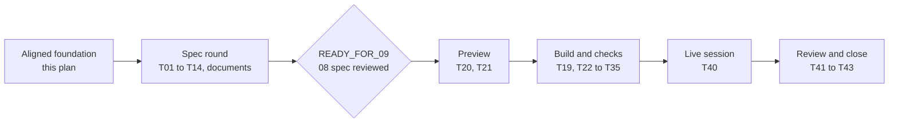

# SPRINT-003 plan: from aligned foundation to a finished sprint

This is the single authoritative task list for SPRINT-003 (Alice.Good.Meetings, restarted 18 November 2026), prepared by 07 Planning after the foundation was reconciled in the [alignment report v4](03.10-sprint-003-alignment-report-v4.md). It is a proposal for Pablo and the owners: it starts no task, approves nothing and is a draft. Every task cites a commitment ID from the [brief v2](03.8-sprint-003-review-brief-v2.md).

*Documents first, then a gate, then the preview, because the preview fixes the bullet and details lengths the build needs.*

## Rules this plan keeps

- **One list.** The tasks are on the [specification round](03.9.1-sprint-003-plan-specification.md) and the [build, checks and live session](03.9.2-sprint-003-plan-build.md); the [trace](03.9.3-sprint-003-plan-trace.md) maps each commitment to its tasks and splits N5. No second copy exists in another stage.
- **Owners keep their authority.** The owner named does the work; the human decides sprint transitions. A task that edits an application file needs the active sprint and `sprint check-implementation` on every path.
- **Where OpenSpec owns tasks.** None exist for SPRINT-003. 08 creates the change under `openspec/changes/` (T10); its `tasks.md` then owns the build items T22 to T34, and this plan links to it, never copies it. Until then these IDs stand.
- **No second approval.** Each page the owners write is a new draft. A passing check, a drafted spec or this plan grants no approval.

## Sequence and dependencies

1. T01 and T02 close wording items from the reconciliation; neither blocks T10.
2. 08 writes T10 to T13. Pablo reviews the specification (T14); he may change any accepted default there.
3. Governance records `READY_FOR_09`. Nothing is coded before it.
4. 09 builds the preview (T20); Pablo approves it by hash (T21). Only then may `index.html` change (T26) and the length limits be fixed (T22).
5. The service, the run script, the tests, the page check and the statements run in parallel where files differ (T23 to T35).
6. All checks pass and the package check holds before the live session (T40). Pablo records pass or fail by the rule he decided.

## Not planned

No POC: the 06 decision stands. No second model call, no collapse control and no package notice before Start: Pablo decided those out. The print option (T25) is an accepted default and may be dropped by Pablo.
Hook trust is not assessed. Return to [Planning](README.md).
