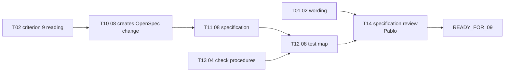

# SPRINT-003 plan: the specification round

This page belongs to the [SPRINT-003 plan](03.9-sprint-003-plan.md). It lists the document tasks that must finish before any coding. None edits an application file, so none needs the sprint gate. "Needs" names the earlier task or decision.

*Seven document tasks end in one review. T14 is the only one that needs Pablo's time.*

| ID | Task | Owner | Needs | Commitment | Done when |
| --- | --- | --- | --- | --- | --- |
| T01 | Replace "unavailable state at Start" with "on load, before Start" in `03-planned-improvements.md` and the B2 row of `03.2`; refresh `02-current-capabilities.md` at closeout | 02 Purpose | none | S003-NOKEY | The Purpose pages say what 03, 04 and 05 say |
| T02 | Confirm that criterion 9's "only those are sent" means the answer request alone, as Architecture's data statements scope it; the record keeps its text | Pablo, via 00 Governance | none | S003-CONTEXT | A recorded yes or a changed reading; no sprint command |
| T10 | Create the OpenSpec change for SPRINT-003 under `openspec/changes/` (name chosen by 08), with proposal, design, specs and `tasks.md`; it uses the installed OpenSpec workflow and cites the nine criteria and these IDs | 08 Specs | T02 | all twelve | The change validates and its tasks cite commitment IDs |
| T11 | Specify, as exact contracts: the request object and result fields (bullets and details separate); the controller states and Stop rules; the seven labels, including the reasons for General and the Failed and Unavailable wording; `/health` fields; the three no-key cases; the package loader (README skipped, 20,000 limit, over-limit not used, never cut); one retry; the timing points with a speech-start time; the optional print option; the fixture hooks for the generator and transcription; the preview contract; `poc/alice-run.sh` steps and exit codes | 08 Specs | T10 | ANSWER, DETAILS, CONTEXT, NOKEY, RUN, GLANCE, LIVE, TESTS, PAGECHECK | Each rule is testable and cites its stage page; limits marked provisional where the preview fixes them |
| T12 | Map each specified rule to a named service test, a page-check case or a shell-check step | 08 Specs | T11, T13 | TESTS, PAGECHECK, RUN | No rule without a check and no check without a rule |
| T13 | Write the procedures of the package check (digests, shingle comparison reporting counts only) and the statement check; decide where a reviewer-run script lives so no live component can import it | 04 Benchmarks, with 08 | T11 | CONTEXT, STATEMENTS | Two procedures a reviewer can follow, with the failure rule |
| T14 | Specification review: Pablo reads the specification and the defaults it relies on and may change any; 10 Review and Release checks it against the nine criteria | Pablo; 10 ReviewQA | T12 | all twelve | Recorded outcome by Pablo; then 00 Governance records `READY_FOR_09` or a reason it is not |

T11 is large. The 08 stage may split it into pages of at most fifty nonblank lines and one OpenSpec spec per capability. A rule the specification cannot fix without the preview, such as bullet length, is written with its provisional value and the task that fixes it (T22).
The two Purpose items from the reconciliation are not specification work: T01 is wording only.
Return to the [plan](03.9-sprint-003-plan.md) or to [Planning](README.md).
