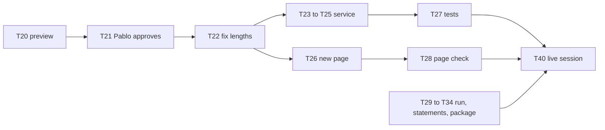

# SPRINT-003 plan: preview, build, checks and live session

This page belongs to the [SPRINT-003 plan](03.9-sprint-003-plan.md). Nothing here starts before `READY_FOR_09` (T14). Each application edit needs the active sprint and a passing `sprint check-implementation` for its path. 09 Coding is the owner unless another is named; "OpenSpec" tasks move to the change that 08 creates in T10.

*The preview gates the page and the length limits; the service can proceed beside the page.*

| ID | Task | Owner | Needs | Commitment | Done when |
| --- | --- | --- | --- | --- | --- |
| T19 | Record the baseline cue, Focus and Live text sizes of the page at revision `7d60c0f` as the constants rule PG-3 reads (OpenSpec task 1.3); a reviewer other than the builder | 10 ReviewQA, proposed; 00 Governance assigns | T14 | GLANCE, LAYOUT | Sizes recorded with their method before T26 starts |
| T20 | Build the static preview page under `poc/` or `images/` with invented sample text: the seven states, Shown with the shortest and the longest content, at 1280 × 900 and 390 × 844, and Shown with each cue | 09 Coding | T14 | PREVIEW, LAYOUT, GLANCE, DETAILS | Files exist, hashes recorded, no microphone, key, package or OpenAI use |
| T21 | Approve, change or reject the preview, including where Clear live, Start and Stop listening, the cue buttons and the status panels sit | Pablo | T20 | PREVIEW, LAYOUT | A dated approval naming the files by hash |
| T22 | Fix the bullet and details length limits and the control placement from the approved preview, in the OpenSpec change | 08 Specs | T21 | GLANCE, DETAILS | Limits are no longer provisional |
| T23 | Package loader, request object, injected generator and controller: Focus-version binding, replace on every change, one retry, limits, Stop rules, text-free audit and timing events | 09 Coding | T22 | ANSWER, CONTEXT, DETAILS | Unit-level behavior matches T11 with a fake generator |
| T24 | `/health` fields, key states (absent, empty, rejected), start without `poc/.env.local`, page Unavailable state on load with Start disabled | 09 Coding | T22 | NOKEY | No OpenAI connection without a key |
| T25 | Optional: the off-by-default option that prints the assembled request to the terminal, with its private-text warning | 09 Coding | T23 | CONTEXT | Printed nowhere else; Pablo may drop it |
| T26 | The new page: `index.html`, `app.js`, with Markdown companions `index.md` and `app.md` for each changed source | 09 Coding | T21, T24 | LAYOUT, GLANCE, ANSWER, DETAILS, NOKEY | Page matches the approved preview; details scroll inside their area, no collapse control |
| T27 | Service tests in `poc/poc.test.mjs`: the named cases of T12, the three no-key cases, the 20,000 boundary; companions updated | 09 Coding | T23, T24 | TESTS, ANSWER, NOKEY, CONTEXT | `node --test poc/poc.test.mjs` exits 0, the 19 existing cases still pass, none calls OpenAI |
| T28 | Extend `poc/browser-protocol.mjs` to drive all seven states from fixtures at both sizes, with the layout part of the glance check | 09 Coding | T26, T23 | PAGECHECK, GLANCE, DETAILS | Reported as its own result, apart from T27 |
| T29 | `poc/alice-run.sh`: start, reuse a current service, refuse another program, never restart during a session, never print the key; companion `.md` | 09 Coding | T22 | RUN | The three outcomes behave as T11 says |
| T30 | Shell check of T29: each outcome, exit code and message | 09 writes; 10 ReviewQA reviews | T29 | RUN | Recorded results for all three outcomes |
| T31 | Apply the root `AGENTS.md` data statements from [03-data-statements.md](../05-high-level-design-and-architecture/decisions/Proposed%20answer%20and%20its%20context/03-data-statements.md) | Pablo or ASDG Admin, on his instruction (00 Governance cannot write this file) | T27, and the 50-line condition below | STATEMENTS | Wording matches the shipped behavior, not before; the file stays within 50 nonblank lines |
| T32 | Apply the `poc/README.md` statements, inside the sprint gate | 09 Coding | T27 | STATEMENTS | Same as T31 |
| T33 | Statement check: compare each sentence of both pages with the request-object assertion | 04 Benchmarks | T31, T32 | STATEMENTS | Any difference fails |
| T34 | Package check before any billable run: file list with digests, shingle check against `eval-data/` reporting counts only | 04 Benchmarks, run locally | T13, package in place | CONTEXT | No benchmark material, or the run is invalid |
| T35 | Write the reviewer script `poc/review/package-check.mjs` and its companion from 04's [procedure](../04-benchmarks-and-eval-strategy/03.8-sprint-003-package-and-statement-checks.md); no `poc/` source outside `poc/review/` imports it, and the reviewer runs it by hand (OpenSpec task 7.4) | 09 Coding | T22 | CONTEXT | ST-57 passes; the script exists before T34 |
| T40 | One live session by the [script](../04-benchmarks-and-eval-strategy/03.6.1-sprint-003-live-session.md), with his package, the key and synthetic or fresh questions; delays and the speech-start pause recorded | Pablo | T27, T28, T30, T33, T34 | LIVE, all | Pass or fail by the 18 November rule |
| T41 | Review the exact candidate against the nine criteria | 10 ReviewQA | T40 | all | A review record with evidence |
| T42 | Refresh current-state pages, including the 02 capabilities and 05 current architecture, and record the results in 04 | 02, 03, 04, 05 | T41 | all | Pages cite the built revision |
| T43 | Sprint review, then closeout or amendment | Pablo, via 00 Governance | T41 | all | His decision; no command here |

Root `AGENTS.md` is a protected control target: `check-write` for 00 Governance returns "WRITE BLOCKED", observed 18 November 2026. It has 54 nonblank lines and the update engine refuses to plan an adapter refresh above 50, so T31's sentence must fit once Pablo has decided how to shorten the file.
Return to the [plan](03.9-sprint-003-plan.md) or to [Planning](README.md).
